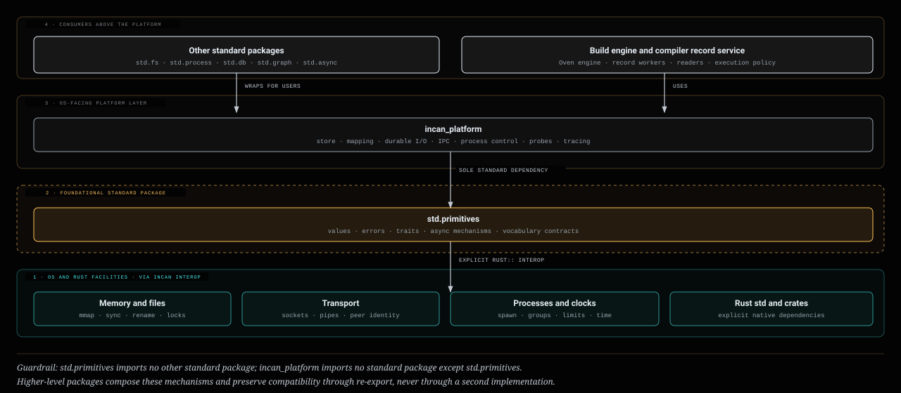
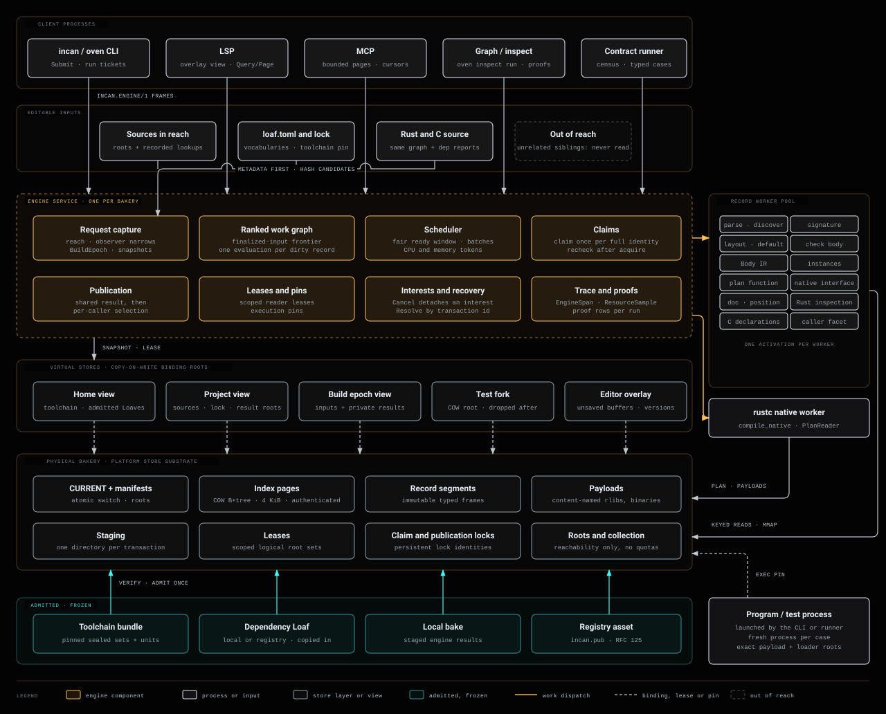
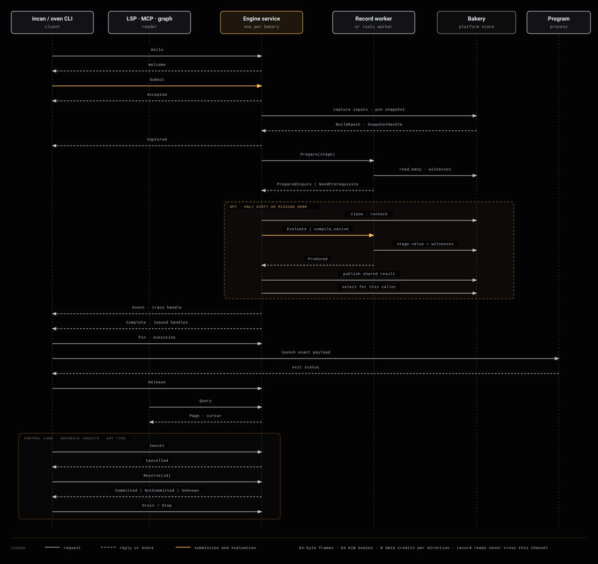
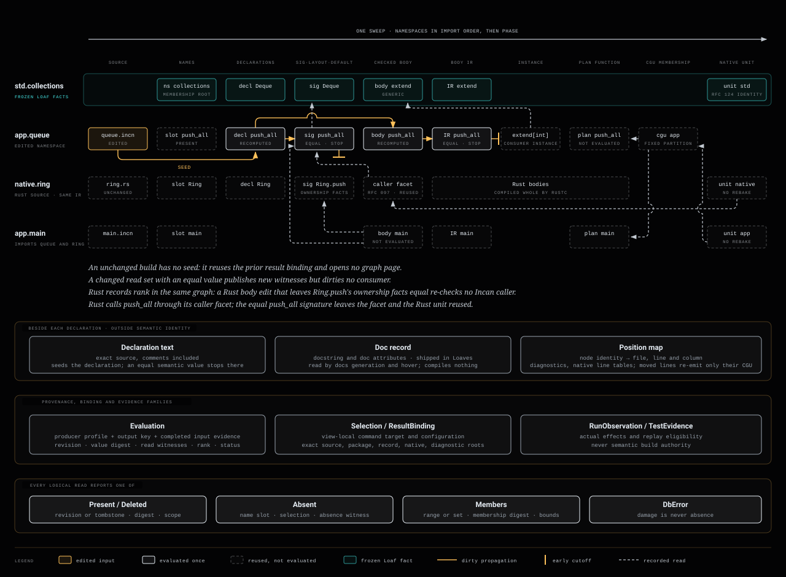
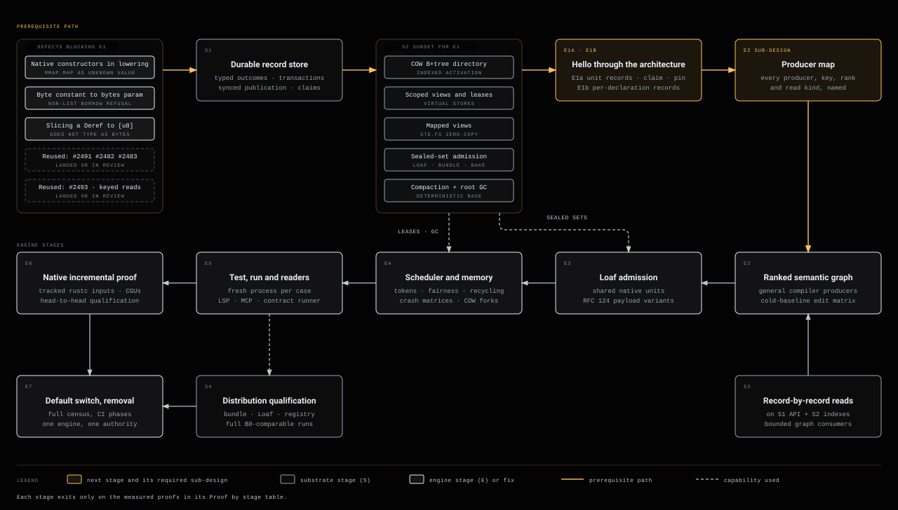

# Build engine architecture

This page is the architecture that [DD-0013: The Incan build engine](../../design_records/0013_the_incan_build_engine.md) commits to. It describes the engine end to end: the rules it follows, its layers, processes and stores, its protocols, the compiler's producer boundary, scheduling, storage discipline and readers, then the delivery stages with their proofs and where each component lives. [Detailed contracts](#detailed-contracts) holds the full contract behind each part. The storage contracts the engine relies on are in the [bakery storage design](bakery_storage_design.md); where that page differs from this one, this page governs.

## Overview

An invocation selects an immutable input snapshot, asks for named results, and obtains handles to facts already present or computed once from final inputs. **One resident engine serves one physical bakery.** Homes, projects, test forks and editor overlays are virtual stores over that bakery. Compiler workers evaluate one record family at a time through keyed, mapped reads. The native route remains the pinned rustc route of DD-0004.

## Governing rules

These rules govern every component below and every review of its implementation.

1. **One home, no split brains.** Each fact, mechanism and decision has exactly one home. No second cache, ledger, freshness check, scheduler, trace channel or storage path exists beside the one named here. The [Code map](#code-map) names that home per component and flags every place where the reused code still has two.
2. **Simple, directed implementations.** Each component does one job in one direction of dependency. Engine policy calls the compiler's producer contracts and the store's substrate contracts; neither calls back into engine policy.
3. **Clear, deliberate APIs.** Each component's API is named, minimal and documented as a contract: inputs, outputs, outcomes and ownership. No component reaches into another's internals. A typed outcome replaces every string-parsed error.
4. **One foundation below the platform and library stack.** `std.primitives` owns the foundational contracts and native mechanisms. The platform imports that package as its sole standard dependency and owns the OS-facing store substrate, mapping, durable I/O, IPC, process control, resource probes and tracing. Other standard packages and the engine sit above the platform and never reimplement either layer.
5. **The platform wraps, it does not reimplement.** The platform reaches OS and Rust facilities thinly, through Incan interop. Low level means precise and minimal, not homegrown.
6. **Incan only, no Cargo.** Engine policy, planning, scheduling, admission, tests, tracing and reader APIs are Incan. The only Rust authored for the engine and record service is the three bootstrap adapters in [Language and platform boundary](#language-and-platform-boundary). There is no Cargo invocation, including acquisition, and no Python component.

## Layers



| Layer | Owns | Does not own |
| --- | --- | --- |
| 1. OS and Rust facilities | `mmap`, file and directory sync, atomic rename, locks, clones, sockets and pipes, peer credentials, process spawn and groups, limits, clocks | Anything Incan-specific |
| 2. `std.primitives` | Foundational values, errors, traits, async mechanisms and vocabulary contracts, backed directly by native dependencies where needed | Higher-level library policy or a dependency on another standard package |
| 3. Platform | Store substrate (`incan_platform.store`, RFC 165), memory mapping with lifetime-safe views, durable I/O and publication ordering, IPC and peer identity, process control and groups, resource probes, tracing | Compiler meaning, package policy, user-facing ergonomics, or a standard dependency other than `std.primitives` |
| 4. Other standard packages | User-facing surfaces over the platform and primitives (`std.fs`, `std.process`, `std.db`, `std.graph` and peers) | A second implementation of a foundational or platform mechanism |
| 4. Engine and compiler record service | Requests, ranked work, scheduling, claims, selection, readers, run and test | Storage layout, OS access outside the platform |

The store substrate is the one RFC 165 specifies. `std.db` is its public typed surface; the engine and the compiler record service consume the substrate contract directly, as RFC 165 permits, so opening the compiler's own facts never depends on a query library. Families, record identities, revisions, views, snapshots, transactions, relationships, read traces and sealed sets mean what RFC 165 defines; a read witness here is one entry of an RFC 165 read trace. The bakery adds only its compiler families and the engine's policy. Readers traverse stored relationships through RFC 166's `GraphRead` protocol in `std.graph`, over the same snapshot, never through a second in-memory graph.

## System architecture



| Process | Owns | Holds while idle | Ends when |
| --- | --- | --- | --- |
| `incan` / `oven` CLI | Arguments, terminal streams, request interest, the launched program | Nothing beyond its command | Its command or child finishes |
| Engine service | Capture, the ranked work graph, scheduling and tokens, claims, publication, leases and pins, interests, traces | A store descriptor, bounded buffers, worker descriptors and observer control state; no decoded program, Loaf or ABI closure | Explicit stop, or 600 s without client, worker, effect or pinned reader |
| Record worker | One compiler activation at a time | Executable code and small protocol state | Unsafe cleanup, crash, incompatible generation, excess idle footprint, or 10 s idle |
| rustc native worker | One native unit through a record-backed `PlanReader` | Nothing semantic | The native invocation ends |
| Program / test process | Its runtime and effects | Its own state | Exit or explicit cancellation |
| LSP / MCP / graph / contract runner | Document versions, snapshot and cursor handles | Handles only, never a decoded compiler world | The session ends |

The engine is singular per `(StoreId, engine protocol and profile generation)`, guarded by a store-level service lock and startup handshake. The Oven executable carries the internal service entry and the compiler driver carries the internal record-worker entry; there is no new executable and no storage daemon. All durable state is in the platform store. Queues, sockets, tokens and in-flight buffers are disposable control state; a crash recovers desired work from captured inputs and committed results.

## Physical bakery and virtual stores

The physical bakery holds immutable records, revision frames, copy-on-write B+tree index pages (4 KiB, authenticated), content-named payloads, staging, leases, claim locks and roots, behind one atomically switched `CURRENT` manifest. It knows no compiler, Loaf or test type; Oven supplies typed families over the generic record contract.

A virtual store is a set of binding roots selected over that bakery:

| Name | Meaning |
| --- | --- |
| `StoreId` | Persistent identity of one physical bakery; never part of compilation identity |
| `ViewKey` | Stable identity of a mutable logical view (a home catalog, a project head) |
| `ViewRevision` | Content-derived binding-root identity; unchanged bindings give the same revision |
| `SnapshotHandle` | Store, manifest, view revision, allowed root set, lease and format profile; a descriptor, not a mapped closure |
| `BuildEpoch` | One captured source and configuration selection plus its private result view |
| `ExecutionHandle` | Exact native unit, payload and loader roots, and an execution pin |

Forking copies a root descriptor; the first differing binding path copies index pages. Reads use the child's root directly and never walk a parent chain. Views publish by comparing their expected prior revision; there is no implicit merge-back. A home finds its bakery through a small `<home>/bakery.view` descriptor (`incan.store-view/1`: store id, locator, home view key) and nothing else.

Three questions have three answers: **available** (bytes present and intact), **admitted** (origin, producer, format and capability closure accepted by policy) and **selected** (this view binds those exact revisions). A digest hit answers only the first. Scoped leases pin a view's logical roots and the index generations needed to reach them, not every other view's payloads. Virtual stores are same-user isolation, not a security boundary.

## Request protocol



`incan.engine/1` is separate from `incan.compiler-worker/1`. A frame header is 64 bytes, little-endian: magic `INCENG01`, major and minor version, message tag and flags, 128-bit session id, 128-bit request id, per-direction sequence, payload length (at most 65,536 bytes) and reserved zero bytes. Bodies use a versioned tagged binary schema authored as Incan models; decoders check lengths before allocating and never cast bytes to native layouts. Each direction has eight data credits, with a separate control lane for cancellation and acknowledgment. Records never travel on this channel: workers read them from the leased store.

| Message family | Contract |
| --- | --- |
| `Hello` / `Welcome` | Negotiate profile, service and compiler generation, store identity, peer identity and limits before any work |
| `Submit` / `Accepted` / `Captured` | Command kind, view, input selection and requested roots; acceptance precedes capture; `Captured` returns the immutable `BuildEpoch` and initial snapshot |
| `Prepare` / `NeedPrerequisite` | The worker derives compiler-owned selectors, ranks and demands; a missing earlier-rank input is a scheduling fact, not a diagnostic |
| `Evaluate` / `Produced` | A ready batch of records with one activation scope, or one native unit; staged results, read-witness root, diagnostics and counters |
| `Query` / `Page` | Bounded read-only snapshot queries with snapshot-bound cursors |
| `Event` | Progress or trace handles; never program console bytes |
| `Complete` | Caller-specific committed snapshot, admission proof, leased handles and binding outcome |
| `Cancel` / `Cancelled` | Detach one interest; shared work continues while another interest remains |
| `Resolve` | `Committed`, `NotCommitted` or `Unknown` for a transaction after a lost acknowledgment; never reruns user code |
| `Pin` / `Release` | Scoped reader and execution leases |
| `Drain` / `Stop` | Stop accepting, settle or cancel, release resources, transfer service ownership |

Request states run `Accepted → Capturing → Planning → Waiting/Running → Publishing → Complete`, with `Cancelled`, `Failed` or `Superseded` as terminal alternatives. Work states run `Discovered → WaitingInputs → Ready → Claiming → Rechecked → Producing → Staged → Committed`; a hit skips producing.

## Capture and freshness

Capture turns a request into a `BuildEpoch`: the exact editable inputs the request depends on, each checked as cheaply as its kind allows.

| Input | Examples | How capture checks it |
| --- | --- | --- |
| Frozen | Installed toolchain, standard library, admitted Loaves (registry or local), anything stored under its content name | Never. Each is verified once at admission and cannot change after that; capture does not stat, read or hash its files. Record integrity is still checked on every read (S1) |
| Editable, in reach | Root files, the files their recorded lookups resolve to, `loaf.toml`, the lock, the vocabularies `loaf.toml` declares, the toolchain pin | Metadata first; only candidates are read and hashed |
| Editable, out of reach | Files no recorded lookup reaches, such as unrelated sibling fixtures | Never |

**Reach.** A request names its roots: a file for `run`, a test selection for `test`, an open document for the LSP, the whole package for `build` and `bake`. Reach is the code graph: the recorded ancestors of the requested declarations, whatever their language.

- Every import lookup is recorded as a witness, whether it resolved to a file or was absent. Next time only those exact paths are checked again, so a new file matters only when it appears at a path a recorded lookup resolves to. `incan run file0001.incn` in a folder of 1,500 unrelated fixtures checks that file, its imports and the project configuration, and never lists, checks or reads the other 1,499.
- `build` and `bake` of a Loaf root at the package's whole membership: capture lists the package's source directories and checks every member, metadata first. Test fixtures are not members of a Loaf, so they stay out of that listing.
- Incan code has no action at a distance. What a file means comes only from what it imports, its Loaf's `loaf.toml`, and the vocabularies `loaf.toml` declares; Incan's own syntax counts as one of those vocabularies. Any later construct that can affect a file without being imported by it, such as extensions, must be an explicit edge in that file's reach, and the code graph must show it.
- A namespace assembled from a listing is captured once with its listing as a recorded input. The change observer, and the LSP as edits happen, invalidate it when the listing changes.
- Another Loaf, local or registry, is its own entry in the bakery. It is admitted by copying its content into the store, as `pip install <path>` copies rather than links. Once admitted it is frozen for every consumer. Edits to it are checked only by requests rooted in it, and its consumers see them when it is admitted again.
- Loaves developed together belong to one workspace. A workspace is a single root: its member Loaves' sources are all editable sources of that root, checked by reach like any other source, with no re-admission step between them.
- Rust and C source a Loaf carries itself follows the same graph. The compiler's own dependency report (rustc's dep-info, the C compiler's dependency file) only adds reads the graph cannot see, such as `include_str!`, environment variables and headers. A read that neither the graph nor the compiler reports, such as an untracked read inside a procedural macro, must be declared in `loaf.toml`; otherwise it is outside the reach.

**Freshness within reach.** Capture decides freshness from file metadata first, as the first engine's retained owner did, where unchanged runs took 11–15 ms. A file whose inode, size, nanosecond mtime and ctime, and mode all match the captured record is unchanged and is not read; only files that differ are read and hashed. While an OS change observer's coverage is valid, it narrows the candidates further, so an unchanged request does not even stat the whole reach. Metadata only detects change; content identity stays the hash of the bytes. Unlinking a hard link changes the surviving inode's ctime, so ctime is never used to verify a file that is being moved concurrently. Capture records the exact bytes it admitted, retries a file that changes while it is being read, and reports an unstable read after three attempts. A no-op request borrows the existing view revision and writes nothing. The proof for an unchanged rerun is zero source reads and zero hashes.

## Rust and C interop

- **No crates.** The engine never deals with crates. Rust and C libraries reach a project only as Loaves, frozen like any other.
- **One IR.** Incan and Rust are not two separate worlds: they reach through the same IR, the unified type substrate of RFC 121. A Rust declaration is a declaration record and its signature a signature record, ranked in the same graph as Incan's. Signatures rank before bodies regardless of language, so a type that crosses in both directions forms no cycle.
- **Interop facts.** For Rust these are what Rust inspection extracts: signatures plus the ownership metadata duckborrowing needs. That means whether each receiver and parameter is taken by reference, mutable reference or value, Copy and Clone, Deref targets, and lifetimes in signatures. For C they are its declarations. The checker and the lowering decide borrowing from those facts alone.
- **Early cutoff across languages.** A Rust or C unit is compiled whole. A body edit that leaves its interop facts equal stops at them, so it never re-checks the Incan code that calls it. A change to a borrow shape changes the facts and re-checks every Incan caller.
- **Both directions (RFC 097).** Incan calls Rust through the interop facts. Rust calls Incan through RFC 097's caller facet. Rust inspection records which Incan exports a Rust unit references. The caller facet is a record derived from those references and the exports' signature records, the caller artifact is built from the facet, and the Rust unit is compiled against it. An Incan body edit that leaves an exported signature equal rebuilds neither the facet nor the Rust caller.
- **Compiler-private access.** Any Loaf may use rustc's internal interface (DD-0013 supersedes DD-0004's rule that only the driver Loaf's own units may), Incan units as well as Rust facets, by declaring it in `loaf.toml` with the keys a Rust facet already uses: `unstable_features`, `toolchain_components` and `sysroot_dependencies`. There is no further gate. The declaration is part of the unit's identity, so a unit built without it never stands in for one built with it, and the driver honors it only from the unit description, after its identity check. An undeclared unit is refused.

## Ranked work graph



The graph wraps DD-0012's compiler facts with evaluation provenance. `RecordKey` names the question, `RevisionId` the immutable state, `ValueDigest` the canonical semantic answer, and an `Evaluation` how that answer was obtained. Physical location, request ids and home locators are never semantic inputs.

For a new source epoch the engine:

1. captures changed sources, configuration and namespace values and compares their semantic projections;
2. reads reverse edges only for changed projections in the selected view;
3. settles preparation, then processes dirty ready records in rank order once all their dirty predecessors are final;
4. validates the prior evaluation's witnesses and reuses the answer without invoking the producer when they hold;
5. otherwise claims the completed computation key, rechecks, evaluates once and publishes the value with its observed edges;
6. propagates only changed subscribed values; an equal value stops that path;
7. derives native-unit descriptors from the finalized roots and publishes the result binding against the expected view revision.

A value producer that asks for an unfinished supplier returns a typed producer-contract failure. There is no whole-program lower-again loop. The engine does not change checking scope: every body is checked, unreachable ones included; codegen reachability is a separate question.

| Command | Requested roots | Work it never implies |
| --- | --- | --- |
| `build` | Terminal carrier and native unit | Packaging or executing |
| `oven bake` | Loaf-shaped carrier, sealed set, receipt | Running package code during admission |
| `run` | The same program unit as `build`, then an execution action | A second compiled identity for the verb |
| `test` | Discovery and harness units, then fresh case executions | Treating cached outcomes as executed cases |
| `check` | Checks, diagnostics, metadata-only provider units | Code generation or linking |
| `fmt` | Syntax and source records, formatter result | Body IR, native units, unrelated packages |
| Census | A paged collection of the same requests | A second engine or process pool |
| LSP / MCP / graph | Named roots and projections at the captured snapshot | Whole-workspace materialization |

## Compiler producer boundary

The compiler exposes three versioned contracts; the engine never interprets the AST or parses refusal strings.

```text
prepare(stage, input_snapshot, demand_page, producer_profile)
  -> PreparedInputs(required_keys, rank_certificate, selector_witnesses)
   | NeedPrerequisite(keys, earlier_rank) | SemanticRefusal(diagnostics) | CompilerFault(details)

evaluate(ready_work, input_snapshot, prepared_inputs, scoped_reader)
  -> Produced(value_ref, semantic_digest, read_witness_root, diagnostic_root, counters)
   | SemanticRefusal(diagnostics, read_witness_root) | CompilerFault(details)

compile_native(native_descriptor, plan_reader, payload_directory)
  -> NativeOutputs(payload_manifest, receipt, counters) | NativeRefusal(diagnostics) | CompilerFault(details)
```

| Producer | Inputs by key | Output |
| --- | --- | --- |
| Parse / discover | Source revision, syntax profile | Declaration and source-map pages, namespace candidates |
| Header / signature | Declaration source, final imported bindings | One signature, or an explicit compiler-owned group |
| Layout / default | Typed facets and earlier layouts or defaults | One layout or default value |
| Check body | Body source and its final environment | Checked body, diagnostics, read set |
| Body IR | Checked body and required facts | One Body IR body |
| Instance preparation | Canonical arguments and a frozen generic definition | Consumer instance keys and demands |
| Plan function | Body IR or instance, runtime and layout facts | One `PlanFunction` |
| Native interface | Selected native declarations, stable CGU membership, exact externs | Native descriptor and native input roots |
| Doc and position | Source revision of one declaration | Doc record and position map, outside semantic identity |
| Rust inspection | A Rust source unit and the frozen facts it reads | Declaration, signature and ownership records; the Incan exports it references |
| C declarations | A C unit and the headers its compiler reports | Declaration records |
| Caller facet (RFC 097) | Referenced Incan exports and their signature records | One caller facet record |

The `scoped_reader` offers keyed lookup, `read_many`, bounded field access, payload access and exact witness recording, read directly from the mapped store. Every read reports one of RFC 165's record states, `Present`, `Deleted` (a tombstone) or `Absent` (with its name slot and selection), or `Members` (with range bounds), or a `DbError`; a missing input is never a semantic absence, and damage is never absence.

Native units take their full RFC 124 identity before claiming. Command names, request ids, view ids and temporary paths never enter it. External identity equals unit identity on the stock rustc route. Codegen-unit membership hashes full identities into a fixed partition count that is part of the profile. Rustc incremental stays off until every overridden query has a tracked per-definition fingerprint; when qualified, incremental state is an immutable seed cloned into private scratch, never semantic authority.

### Apple SDK identity boundary

An Apple SDK is an input only to work that actually reads it. Incan and Rust library compilation uses the pinned
compiler identity, deployment selection, source, invocation and linked artifacts, but not the selected SDK. Final Incan
program and test links, debug shared-library/carrier links, final Rust binary and test links, dynamically linked Rust
libraries (including proc macros), and units that declare C headers additionally include the content identity of
`SDKSettings.json`. SDK discovery and hashing therefore do not run for statically linked library-only work. A new Xcode
installation can reuse static libraries while it must relink executable, dynamic-library and C-ABI outputs.

This boundary was checked on macOS by compiling the same paths and arguments first with Command Line Tools SDK 27.0
and then with Xcode SDK 27.2. `incan_lang` and the `incan_std_testing` Rust facet produced byte-identical rlibs. The
`incan_stdlib_testing` Incan library produced byte-identical `.incnbody`, `.incnlib`, `.native.json`, `.rustabi` and
rlib artifacts. A small executable differed only at the expected final-link boundary: its `LC_BUILD_VERSION` SDK field
changed from 27.0 to 27.2. The comparison deliberately reused one working directory and output path; an earlier
comparison with different working directories demonstrated that rustc embeds that directory in metadata and is not a
valid SDK-only experiment.

Interfaces outlive their implementation language. Wire schemas and durable records carry typed identities and scoped handles, never Rust layouts or pointers.

### Producer-map design

This section contains the implementation design supporting [DD-0015](../../design_records/0015_compiler_producer_map.md). The [settled design points](#settled-design-points) give the reasoning behind that record's decisions 6 to 8. This material does not change DD-0013's accepted contracts.

The decision record states the choices and their rationale. This section owns the producer inventory, data contracts, preparation and evaluation protocol, migration steps, examples and verification matrix.

#### Visitors and independently reusable contributions

A visitor or compiler pass computes one contribution to the representation of a declaration. A producer makes that operation addressable by record key, prepares its inputs and publishes the result with its observed dependencies. Each contribution has an owning producer, a value digest and its own dependency evidence. They form one logical representation without making every contribution share one invalidation boundary: changing ownership facts must not invalidate a reader that observed only an unchanged signature.

The engine schedules and reuses those contributions; it does not walk syntax to derive compiler facts. Producers enter the existing semantic operations, whose visitors read dependencies through the scoped reader. Wrapping a whole-program check and extracting one owner's result is a projection, not the intended per-record producer.

#### Motivating edit

Consider:

```incan
def greeting() -> str:
    return "hello"


def main() -> None:
    println(greeting())
```

Changing `"hello"` to `"hullo"` should check, lower and plan `greeting` again and nothing of `main`, because `main` read only `greeting`'s name slot and signature, and neither changed. A comment added above `main` should check nothing again: it moves `main`'s lines, so only `main`'s position map and the native line tables change. The proposed contracts below explain both outcomes without a special case for either.


#### Operating contracts

1. **One producer per record family.** The [producer map](#families-and-producers) is the one home of which compiler producer answers which family. Within one compiler generation exactly one producer is selectable for a family; the compiler record service selects it with one match over a closed family enum. A family the selected profile does not cover answers `UnsupportedProducer`, and records mode then fails rather than falling back. The engine never chooses a producer: it asks for a key.

2. **Keys name questions; the compiler supplies identities.** A record key is its family, identity, identity profile, origin, facet and context. For a declaration facet the identity is RFC 106's stable declaration identity. A callable's identity includes its checked signature, so the producer that computes signatures is keyed by the declaration slot it fills (namespace, name, kind) and publishes the slot's members with their identities. Every later facet is keyed by a member identity. A signature edit therefore removes one identity and adds another, as RFC 106 states, and the engine invents no continuity. The context holds only what the facet observes, such as canonical type arguments, target and lowering profile. Physical locations, store revisions, table slots, requests, views and homes never enter a key; a position map's key names its source revision only because that is the question it answers (BE-34). One canonical string encoding of a key is both its store key and its key in every in-memory index.

3. **One schema and one digest per value.** Each family has one versioned value schema with one home. Its tags are `incan_lang` registry keys that the Incan schema and the Rust adapters both use, and only the schema validates. A value's digest is the digest of its canonical encoding; for a declaration facet that is RFC 106's semantic digest of that facet. Values hold no positions, comments or documentation: doc records and position maps are separate records with their own digests (BE-34). A value whose digest cannot be computed counts as changed.

4. **Ranks order work and never name it.** A rank is the namespace's position in the import order, then the producer stage, then an order inside a joint group that the compiler supplies. The rank certificate binds the digests of the finalized predecessor roots, not rank numbers, so adding a module reorders work without moving any key or digest. Producers are joint only for a demonstrated cycle: mutually dependent headers, recursive layouts, mutation-effect forwarding, return-carrier flow and shared-read loans. A group's key is its rule and the digest of its sorted membership, and its members keep their own output keys.

5. **Inputs are prepared before values are evaluated.** `prepare` returns the complete read envelope of one output (required reads as a paged root, selector witnesses and the rank certificate), or names earlier-rank prerequisites. `evaluate` reads only inside that envelope, through one scope. Reading an unfinished supplier is `UnfinishedSupplier` and reading outside the envelope is `OutsidePreparation`. Neither publishes a value, and neither is retried. There is no lower-again loop.

6. **Witnesses are the graph's edges.** Every read reports present, deleted, absent (with the exact slot and selection), members (with selector, bounds, membership digest and continuation) or a store error. A completed evaluation publishes, in one transaction, its value, an evaluation record (producer profile, output key, claim key, value digest, receipt root and rank) and its witnesses; forward and reverse indexes derive from those same witnesses. In records mode the graph is the only dependency authority: no unit freshness stamp, capture ledger or process-global cache answers a dependency question.

7. **Change is one ranked sweep with early cutoff.** Changed values seed the sweep, and reverse edges find their readers in the selected view. Readers are processed in rank order once their dirty predecessors are final. A reader whose witnesses all still validate is reused without running its producer; one whose witnesses changed, or cannot be validated, is evaluated once. An output equal to its previous value stops propagation along that path. The producer profile is part of every reuse: a value produced under one profile is never reused, or compared for cutoff, under another.

8. **Producers enter the existing compiler, and projections give way one family at a time.** The Rust checker, the Body IR builder and the Incan lowering remain the only semantic implementations (BE-32). A producer is a record-scoped entry into an existing compiler operation and reads only through its scope. A family moves from projection to producer in one change, which:
   - shows the producer's records byte-identical to the projection's over the oracle corpus;
   - passes that family's rows of the edit matrix against the cold oracle;
   - deletes that family's projection and any Rust-side check of its grammar.

   Two producers are never selectable for one family, and a projection is never a records-mode fallback.

9. **Equivalence is measured against two oracles.** The *cold oracle* is the same engine computing the same captured source in a fresh project view that shares the admitted frozen roots and holds no project results. A warm result is equivalent when it matches the cold result in four things: selected record bindings (key and value digest), rendered diagnostics, native unit identity and payload, and program behavior. In addition, every witness it relied on must validate on the new source. The *legacy oracle* compares the cold result with the first engine: checking-scope membership, diagnostics, the complete plan and behavior. A row's producer count is exact when the warm evaluations are exactly the dirty set computed from two cold runs, before and after the edit.


#### Families and producers

One row per record family. "Reads" uses P for present, D for deleted, A for absent and M for members. Every producer can also end with a store error, which terminates the activation. "State" is the state at the line commit `ee29e866b`.

| Family | Output key | Producer and stage | Reads | Value schema home | Joint when | State |
| --- | --- | --- | --- | --- | --- | --- |
| `source` | origin, logical path | Engine capture (not a compiler producer) | — | Oven capture | — | Delivered (build epochs) |
| `module-header` | origin, logical source | Source projection, `Discover` | P captured source | Oven source projection | One evaluation per source revision with `owner-source` members | Delivered |
| `declaration-index` | origin, logical source | Source projection, `Discover` | P captured source | Oven source projection | One body-independent callable header per declaration; non-callable declarations remain conservative | Delivered |
| `owner-source` | origin, logical source, declaration owner or field-default anchor | Source projection, `Discover` | P captured source | Oven source projection | One evaluation per source revision with the module header; a field default reads only its own exact expression | Delivered |
| `discover` | origin, logical source, syntax profile | Parse, `Discover` | P source; P/A/M vocabulary selection | `internal_models` source records | One evaluation per source revision; member outputs below | None |
| `declaration-source` | declaration slot, header seed | Output of `discover` | — | `internal_models` source records | — | None |
| `doc` | declaration identity | Output of `discover`, bound to its identity when the slot publishes it | — | `internal_models` source records | — | None |
| `position-map` | declaration identity, semantic root, source revision | Output of `discover` | — | `internal_models` source records | — | None |
| `name-slot` | namespace, name, selection context | The one namespace resolver, `NameSlot` | M namespace members; P imported bindings; A exact missing names and paths | `internal_models` namespace records | Never; import cycles stay refused | None |
| `influence` | header seed | Restricted body scanners (hash bounds, closure eligibility, value uses), `Influence` | P body syntax; P/A/M name slots | `internal_models` checker records | Never | None |
| `slot` | namespace, name, kind | Header and signature checking, `Slot` | P member headers; P/A/M name slots; P imported signatures; M influence by target | `internal_models` checker records | Header and hash-forwarding cycles | None |
| `layout` | type identity, observed type arguments | Layout, `Layout` | P slots and earlier layouts; M members | `internal_models` checker records | Recursive layout cycles | None |
| `default` | identity, parameter or field anchor | Default and constant checking, `Default` | P own expression; P/A/M names; P signatures | `internal_models` checker records | Recursive constant dependencies | Writer row inside `declaration` only |
| `declaration` | identity | Declaration validation, defaults' writers, ownership contract, `Declaration` | P slot; P layouts and defaults read | `internal_models.checker_records` (`Declaration`) | Never | Projection only |
| `local` | callable identity | One body's local check, `Local` | P own source and environment; P/A/M every lookup, failed ones included | `internal_models.checker_records` (`Local`) | Never | Projection only |
| `mutation-effect` | rule, membership digest; member projection per identity and parameter | Mutation-effect resolution, `MutationEffect` | P local effect facts; M forwarding edges; A unresolved callees | `internal_models` checker records | Forwarding cycles | Refused by the profile |
| `final` | callable identity | Settlement of one body, `Final` | P own local; P callee effects | `internal_models.checker_records` (`Final`) | Never | Projection only |
| `check-scope` | checking scope, command semantic profile | Aggregation, `CheckScope` | M scope membership; P diagnostic and status roots | `internal_models` checker records | Never | None |
| `body-ir-seed` | executable owner | Per-owner Body IR construction, `BodyIrSeed` | P final, own source, declaration and layout facts | Kernel executable representation | Never | None |
| `representation` | executable owner or group, pass | Return carriers, native representation and shared-read loans, `BodyIrSummary` | P seeds; P callee summaries; M call and implementation edges | Kernel executable representation | Return-flow and shared-loan cycles | None |
| `body-ir` | executable owner | Body IR finalization, `BodyIr` | P own seed and summaries; P callee loan summaries | Kernel executable representation | Never | Delivered for graph-eligible free-function owners |
| `instance` | generic identity, canonical arguments, context | Instance preparation, `Instance` | P frozen or local template; P substitutions; M implementation choices | Kernel executable representation | Never; recursion is a reference | None |
| `lowering-demand` | native instance, role, lowering profile | Lowering preparation, `LoweringDemand` | P Body IR or instance; P runtime facades, layouts, frames; A/M facade and provider selectors | `incan_mir_plan` | Layout cycles inside concrete layouts | Bounded ordinary scalar owners: complete semantic Body IR, dependency/profile witness and relative positions; exact runtime signatures retained |
| `runtime-facade` | typed runtime operation | Frozen admission (standard and runtime records) | — | `incan_mir_plan` | — | None (open question 5) |
| `plan-function` | native instance, role, lowering profile | Plan function, `PlanFunction` | P own demand's prepared fields only | `incan_mir_plan` | Never; lexical groups are named | Existing Incan scalar lowering produces loss-checked function products; ordinary synchronous unit-main entry binding is a separate role; uniform line moves rebind positions without lowering |
| `native-interface` | native namespace, target, profile | Native interface, `NativeInterface` | M selected plan, layout, export and entry roots; P exact extern identities; P position maps | `incan_mir_plan`; unit identity stays Oven's RFC 124 function | Never | Complete loss-checked ordinary scalar plan, including concrete model/enum/zip layouts, externals, selected program and current positions; refuses canonical source-trait tokens, statics, exports, tests, generic templates, generated functions and ambiguous owners |
| `rust-inspection` | Rust unit, inspection profile; per-item projections | Rust inspection (named here, built with Loaf admission, E3) | P exact native and source inputs; A/M items | `internal_models` interop records | One Rust unit | Existing extractor, not a producer |
| `c-declarations` | C unit, ABI profile; per-item projections | C declarations (built with Loaf admission, E3) | P headers and options; A/M declarations | `internal_models` interop records | One translation unit | None |
| `caller-facet` | Rust unit, referenced exports, ABI profile | Caller facet, RFC 097 (built with Loaf admission, E3) | M referenced exports; P their signatures | `internal_models` interop records | Only for a qualified foreign header group | None |

The stage order is the table's order, from `Discover` to `NativeInterface`. These are the `ProducerStage` values; the line's enum has nine of them and gains the rest. The three foreign producers rank in their own unit's namespace, before the `Slot` stage of any namespace that reads them.

Each value schema is versioned, and its version is part of its producer profile. Native compilation is not a semantic producer: the engine claims it by RFC 124 identity and calls `compile_native` with a record-backed `PlanReader`.

Two homes decided here, for one family each:

- **`runtime-facade` keys** are typed runtime operations bound to canonical callables, never native path spellings. The compiler architecture review's row 3 found lowering classifying providers by path prefix.
- **The store-backed `RecordSource`** lives with the record contracts in `internal_models`, because it is the one place that knows both the key encoding and the read evidence. The worker host is "not part of the compiler's query interfaces" (its README); it owns activation lifetime and protocol dispatch.

#### Keys and identity

The key model is `RecordKey(family, identity, identity_profile, origin, facet, context)` in `internal_models.record_scope`. Its parts:

- **Declaration identity** is `StableDeclarationId.render_compact()` (RFC 106; `incan_semantics_core/src/stable_identity.rs`). It holds namespace, origin, name, kind, location (module level, or nested owner and binding ordinal) and, for callables, the checked signature.
- **Before a signature exists**, a declaration is addressed by its slot `(namespace, name, kind)` and a header seed. The seed is the digest of the member's normalized header projection, with no positions and no source revision. Equal headers give an equal seed, so a body edit keeps the seed. Two members with identical headers form a collision that the slot producer refuses exactly as the first engine refuses duplicate declarations.
- **The slot record** publishes each member's final identity together with its signature. A revision-local syntax handle is an activation handle only and is never persisted.
- **Non-declaration identities:**
  - a source is its logical path under its origin;
  - a namespace is its module path;
  - an instance is its generic identity plus canonical arguments;
  - a plan function is its native instance identity plus role;
  - a native interface is its native namespace with target and profile.
- **The encoding.** One function in `internal_models` writes every key as a canonical string. That string is the store key and the key of every in-memory index (frontier, witness deduplication, reverse-edge pages). Sets and ordering of key models work; dictionary lookups keyed by models do not run today (probe 4), so maps use the encoding.

#### Values, schemas and digests

- **Checker families** use `internal_models.checker_records` (`incan.checker-fields/9`, profile `incan.checker-free-functions/13`). A record holds a profile, an owner identity, the digest of the owner's position-free semantic syntax, a stage family and ordered canonical fields. Its digest is SHA-256 over the encoding. A body edit always changes that body's checked records, because the semantic syntax digest is part of the value. Consumers in other declarations read slots and signatures, never another body's checked record, so a body edit stops there. Profile 13 also binds the graph-selected final Body IR owner frame and checked expression-type identities to the same checked owner generation, and project-module reads witness the producer declaration's checked stable identity.
- **Field families and profile names** are `incan_lang` registry keys. The Rust adapters emit them and never spell them. The Incan codec is the only grammar check. Rebinding turns validated fields into native scratch for the next Rust consumer and never derives a fact the record does not hold.
- **Source, namespace, doc and position records** are new Incan schemas in `internal_models`. A position map binds `(declaration identity, semantic node anchor)` to file, line and column for one source revision. Diagnostics are stored against node anchors and rendered by joining the current position map.
- **Source projection records** are produced once per changed source before checking. The producer key is `(origin, logical source, incan.source-projection/1)`, its rank is `Discover`, and its only read is the captured source binding. It publishes one `module-header` value containing imports, aliases and other unowned module forms, one body-independent `declaration-index` for pre-check signature and removal invalidation, plus one `owner-source` value per top-level declaration owner. A field default has its own source facet keyed by the declaration identity and field anchor, and that facet contains only the exact default expression; editing it invalidates the default and readers of its value, not unrelated fields or methods. Each value retains its coordinates, while its semantic digest covers only its own exact text. Local and final body activations witness the matching owner value and module header rather than the captured file binding. Cross-module readers additionally witness the declaration index and the producer's checked declaration slot, so a body-only edit stops at the producer while a signature edit or removal invalidates readers before selection.
- **Plan-function and native-interface records** are values of the `incan_mir_plan` models, encoded by one codec owned beside them. The rustc adapter reads them through the `PlanReader`, which is the versioned data schema crossing the native boundary.
- **Body IR records** use the kernel's versioned executable representation. Per-owner records frame the native `Body` with its module identity and logical source provenance. An admitted unchanged editable namespace uses the same kernel codec's complete module frame beside those per-owner records; graph transports treat both forms as opaque bytes and do not maintain a second Body IR schema.
- **Unavailable digests.** A producer that cannot compute a value's digest, for example because its profile refuses a capability, publishes nothing and reports `UnsupportedProducer`. Records mode reports the declaration as not producible; it never reuses.

#### Ranks and joint groups

A rank is `(namespace order, stage, group order)`, carried as `ProducerRank`.

- **Namespace order** is the import DAG of the captured epoch. Admitted frozen namespaces are final on admission and rank before every editable namespace. Circular imports stay refused (DD-0012, decision 4).
- **Stage** is the table's order.
- **Group order** is the condensation order of a joint group's dependency cycle, supplied by the compiler.

Rank numbers exist only in the scheduler's frontier. The rank certificate in `PreparedInputs` is the digest of the finalized predecessor roots the envelope reads, so it changes only when a predecessor's value does.

A joint group is allowed only for:

- mutually dependent headers, including hash-forwarding cycles;
- recursive layouts;
- recursive constants or defaults;
- mutation-effect forwarding cycles;
- return-carrier flow cycles;
- shared-read loan cycles.

The group's key is its rule and the digest of its sorted membership. It runs the existing compiler's fixed point as one evaluation, reports iterations and member visits, and publishes member outputs under their own keys, so an equal member value still stops propagation when membership changes. Inserting or deleting a member recomputes membership from the relation records and may merge or split a group. A group spanning a whole module without a cycle is not allowed. A legal program that fits none of these cycle kinds is a compiler or design finding that blocks its stage, not a new refusal.

#### Preparation and reads

`prepare(stage, input_snapshot, demand_page, producer_profile)` returns one of:

- `Prepared(PreparedInputs)`: the output key, the exact snapshot and profile, the required reads as a paged root, the selector witnesses (including absent and member evidence that preparation itself observed) and the rank certificate;
- `NeedPrerequisite(keys, earlier_rank)`, which is scheduling input, never a diagnostic;
- `SemanticRefusal`;
- `CompilerFault`.

Preparation may scan syntax and selectors; its work is counted separately from evaluation.

`evaluate` opens one `RecordReads` scope bound to the envelope (`prepared_reader`). Each read yields one witness:

| Outcome | Witness keeps | Invalidated when |
| --- | --- | --- |
| Present | key, revision, value digest, selection and selection digest | the key's value digest in the selected view differs |
| Deleted | key and the tombstone's revision | the key becomes present |
| Absent | exact key or slot, selection context, exclusion digest | a record appears at that key or slot |
| Members | selector, order, bounds, membership digest, continuation | the membership digest over the same bounds differs |

An unfinished supplier, damage, a wrong snapshot or profile, a read outside the envelope, or lost witness recording is a fault. A fault is sticky and publishes neither a value nor a partial witness set. `finish()` hands over one complete receipt, including the preparation evidence of an activation that read nothing.

Reads are owned. A read copies the selected value once, out of the store's mapped segment, and counts it. Where a large payload is consumed without decoding, the carrier is an owned anchored `MappedView`, never a borrowed view inside a user-defined generic type (probes 1, 1b and 2). After every activation the worker asserts zero open scopes, zero live record mappings of that request and zero retained decoded values.

#### The ranked graph: evaluations, edges and the sweep

Graph facts live in the bakery, in engine families owned by Oven:

- `evaluation`, per output key and producer profile: claim key, value digest, receipt root, rank and outcome (`Produced` or `SemanticRefusal`);
- `edge-out`, per evaluation and witness;
- `edge-in`, per target key, read kind and reader.

All three are written in the one transaction that publishes the value. The reverse index is a range of `edge-in` keys, read in bounded pages, and is filtered to evaluations selected in the requesting view. The claim key is the digest of the producer profile, the output key and the prepared envelope's value digests and selector witnesses; it never includes the physical manifest, the home or trace configuration.

For a new epoch the engine:

1. compares the captured sources' semantic projections with the previous epoch's;
2. reads the reverse edges of the changed records in the selected view;
3. settles preparation and visits dirty records in rank order once their dirty predecessors are final;
4. validates each prior evaluation's witnesses: `Unchanged` reuses it, rebinding provenance only when revisions changed; `Changed`, or an inability to validate, evaluates once;
5. claims the completed key, rechecks, evaluates and publishes value, evaluation and edges together;
6. propagates only changed values;
7. forms the native descriptor from the finalized roots and selects the result against the expected view revision.

The existing mechanisms from engine mechanics with unit records (E1a) are reused unchanged: capture, claims, publication, caller selection, leases, execution pins and launch. The graph is new code beside them.

Typed dependency ownership splits three ways:

- the compiler owns what a witness means: its read kind and the family of its target;
- the engine owns storing and traversing witnesses;
- the store owns bytes and index pages.

No compiler consumer reads a record any other way than through its scope.

#### Replacing the bootstrap projections

Today `body_check/records` projects a declaration, local or final record out of a `TypeChecker` that checked the whole fixture. That is a test sink. A producer for family F replaces it in one change:

1. **Red case.** A failing contract case names the behavior: for example, editing a private literal of one body evaluates one `local` and one `final` record and no sibling.
2. **Entry point.** The bootstrap adapter (adaptation 1 of DD-0013) gains a record-scoped entry into the existing operation that owns F. The entry reads its inputs only through `RecordReads`, owns its scratch, and publishes F's fields. For `local`, the operation is `BodyCheckScope` with immutable environment views; `check_program_internal` followed by selecting one owner is not a producer.
3. **Cross-check.** On the oracle corpus, the producer's records are byte-identical to the projection's: the canonical controls, the checker's fresh-legacy influence comparison (`influence_facts_match_fresh_legacy_inference`), the free-function baseline and every census fixture the profile covers. Both emit the same schema, so a difference is a defect in one of them, never two answers.
4. **Matrix.** F's rows of the edit matrix pass against both oracles.
5. **Deletion.** The same change deletes F's projection, every Rust spelling of F's tags and every Rust check of F's grammar. The legacy oracle stays: it is the first engine itself, not a projection.

The profile records which families have producers. Raising coverage, such as representing a refused artifact field, is a profile bump; old-profile records are not reused under the new profile.

#### The cold oracle and the edit matrix

For base source S and edit E giving S′:

- **Warm** runs records mode on S, applies E, and runs records mode on S′ in the same project view.
- **Cold** runs records mode on S′ in a fresh project view with the same admitted frozen roots and no project results.
- **Cold-before** runs cold on S as well, so the expected dirty set can be computed.
- **Legacy** runs `INCAN_ENGINE=legacy` on S′.

The comparisons:

- **Equivalence** (warm against cold): equal sets of selected `(key, value digest)` bindings for the requested roots; equal rendered diagnostics, by text and by JSON; equal native unit identity and payload digest; equal stdout, stderr and exit status; and every warm witness valid on S′. Evaluation and edge records may differ between the two (warm carries rebinding provenance) and are compared only for validity.
- **Exact counts** (warm against the cold pair): the expected evaluated set is every record that exists only in the cold run, every record whose own source projection differs between cold-before and cold, and every reader, in the cold-before graph, of a record whose value digest differs or that no longer exists. Warm evaluations must equal that set: more is over-invalidation, fewer is stale reuse. Counts are reported per family.
- **Legacy parity** (cold against legacy): equal checking-scope membership (canonical member sets, unreachable bodies included), diagnostics, complete plan bytes and behavior.

The matrix, with the minimum each row must show:

| Row | Example edit | Evaluates | Does not evaluate |
| --- | --- | --- | --- |
| Body | `"hello"` to `"hullo"` in `greeting` | `discover`; `greeting`'s `influence` (equal value), `local`, `final`, Body IR chain and `plan-function`; `native-interface` | anything of `main`; `greeting`'s `slot` and `declaration` |
| Body, length change | add a statement to `greeting` | as above, plus position maps of declarations after it | other semantic records |
| Comment, blank line, docstring | a comment above `main`; edit a docstring | `discover`; moved declarations' position maps; the doc record | every check, Body IR and plan record |
| Signature | `greeting` returns `int` | the `slot`; a new identity's chain; `main`, whose slot witness changed | unrelated siblings |
| Layout | add a field to a model | `layout`; readers of that layout | functions that never read it |
| Default | change a default's value | `default`; readers that observe the value | readers of its type or template only |
| Namespace insertion | add `def other()` | `discover`; the new slot; readers holding an absent witness at that name | everything else |
| Namespace deletion | delete an unused function | its slot and chain become deleted | records that never read it |
| Absent import | `from helpers import f` before `helpers.incn` exists, then create it | the absent witness's readers | unrelated modules; unrelated new siblings |
| Candidate set | add an overload or trait implementation | readers holding a members witness; equal results stop there | readers of other slots |
| Feature | toggle a feature that selects a name | readers of the feature-selected names | others |
| Toolchain | a new compiler generation | everything (no cross-profile reuse) | — |
| Loaf version | swap an admitted dependency version | readers whose witnesses into it changed | open question 3 |

Robustness rows in the same harness:

- an equal value reached through a changed read set publishes new witnesses and dirties nothing;
- a group splits and merges;
- a damaged record is a store error, recomputed in a new explicit transaction;
- a misprepared envelope is a fault with nothing published;
- a killed worker publishes nothing.

The equivalence and count assertions run as engine tests on small fixtures. Timing samples (at least twenty per edit-loop row, paired with the first engine, in a cold and a warm home) run in the development-loop benchmark, outside CI.

#### Worked example

Cold, for the program in the motivating edit above:

```text
source(app.incn)
  -> discover(app)                    one parse; declaration-source x2, doc x2, position-map x2
  -> name-slot(app, greeting), name-slot(app, main)
  -> slot(app, greeting, function)    member: function:app::greeting|() -> str
     slot(app, main, function)        member: function:app::main|() -> None
  -> declaration(greeting), declaration(main)
  -> local(greeting), local(main)     main reads name-slot(greeting) and slot(greeting)
  -> final(greeting), final(main)
  -> check-scope(app)
  -> body-ir-seed, representation, body-ir   one chain per function
  -> lowering-demand(main)            reads runtime-facade(println_text) from admitted std records
  -> plan-function(greeting), plan-function(main), plan-function(entry)
  -> native-interface(app)            reads position maps for line tables
  -> native bake (claimed by RFC 124 identity), selection, launch
```

After `"hello"` becomes `"hullo"`:

- `discover(app)` runs once.
- `declaration-source(greeting)` has a new body projection and an equal header seed.
- `influence(greeting)` reads the changed body syntax and is evaluated; its value (no hash bound, no closure use) is equal, so the slot's witnesses validate and `slot(greeting)` and `declaration(greeting)` are reused.
- `local(greeting)` reads the changed body projection and is evaluated, and so are `final`, the Body IR chain and `plan-function(greeting)`.
- `local(main)`'s witnesses (name slot and `slot(greeting)`) validate, so `main` evaluates nothing.
- `native-interface(app)` reads a changed plan root and evaluates; the native unit is baked again, whole.

After a comment above `main`:

- `discover(app)` runs once. Both header seeds and body projections are equal, so every semantic record is reused.
- `position-map(main)` changes, `native-interface(app)` reads it and evaluates, and the native unit is baked again for its line tables.
- Rendered diagnostics, if any, show `main`'s new lines.

#### Settled design points

Each quotes the sentence that raised it, then gives the decision DD-0015 records.

1. **Where do Body IR, representation and instance values get their schema?** The architecture page: "Wire schemas and durable records carry typed identities, schema-defined values and scoped handles, not Rust heap layouts, process pointers or Rust trait-object representations." Body IR is a Rust data model (`incan_semantics_core::body_ir`). Loaves already ship it as a versioned whole-module encoding (`executable_representation/module_codec.rs`: postcard with a representation version). DD-0013 does not say whether that versioned representation counts as a schema-defined value. **Decision:** use the kernel's versioned executable representation, framed per executable owner, as the one Body IR schema. That is not a Rust heap layout but a versioned encoding of a schema the kernel owns, and a second Incan model of Body IR would be a second semantic model. The alternative is an Incan-owned Body IR schema, which is a large separate stage.

2. **Which protocol carries `Prepare` and `Evaluate` to a worker?** The architecture page: "`incan.engine/1` is separate from `incan.compiler-worker/1`". Its message table then lists `Prepare / NeedPrerequisite` as "The worker derives compiler-owned selectors, ranks and demands". The engine codec encodes these messages; the worker host speaks only `incan.compiler-worker/1`, whose commands are whole compiles. **Decision:** record activations become a new version of the worker protocol in `incan_worker_host`, the one home of the worker's message family. The unused `Prepare`, `NeedPrerequisite`, `Evaluate` and `Produced` bodies leave `incan.engine/1`, which then stays the client protocol. The other reading puts `incan.engine/1` on the worker, which would give the worker two protocols.

3. **Do the toolchain and Loaf-version rows belong to this slice's exit?** The ranked-graph stage's proof row: "Cold-baseline equivalence for body, signature, layout, default, namespace insert and delete, absent import, candidate set, feature, toolchain and Loaf edits". But Loaf admission (E3) delivers "Bundle, Loaf and local-bake admission (local Loaves by copy) … version diffs", and records mode refuses editable path dependencies. **Decision:** this slice measures the toolchain row as a producer-profile change and moves the Loaf-version row to Loaf admission's exit, which already owns version swaps.

4. **Does this slice's exit include the lowering-library edit row?** The ranked-graph stage's row: "One-record edit reuses sibling checks, Body IR and plans | Efficiency | One lowering-body edit 270.79 s; edited unit 252.02 s". The lowering library depends on two Rust Loaves (`incan_semantics_core`, `incan_lang`), and Loaf admission (E3) delivers "Rust and C units in a Loaf". **Decision:** this slice proves sibling reuse on Incan-only fixtures and the hello edit loop row (316.9 ms median); the lowering-library row is measured when Loaf admission lands, and its proof row says so.

5. **How do frozen standard and runtime records first come to exist?** Compiler reads by record (S3) requires "Std manifest and fact reads replaced by records", while the toolchain release becomes "an `oven bake` of its Loaf graph" only at Loaf admission (E3). Until then the toolchain bundle ships Loaf artifacts (`.incnlib`, `.incnbody`, `.rustabi`), not records. **Decision:** a one-time admission conversion per installed toolchain reads those artifacts and writes records in the producers' schemas through the sealed-set admission path (BE-16). It is the only reader of Loaf artifacts in records mode, and it is deleted when Loaves ship records. Baking the standard library from source at first use is the alternative; it costs a full standard check on a cold home.

6. **Is the bounded codegraph answer this slice's, or the readers stage's (E5)?** Compiler reads by record lists "Bounded codegraph answer for one unit | 64,211,355 bytes, 60,612 records", and the code map says the in-memory node and link structures are "replaced by the `GraphRead` adapter in S3". The readers stage owns "MCP and graph pages". **Decision:** this slice answers one unit's codegraph question as a bounded projection of its persisted declaration, reference and call fields through RFC 166's `GraphRead`. The whole-export compatibility renderer and the MCP pages stay with the readers stage.

7. **When do the process-global standard caches go?** The code map: "Process-global `ARTIFACTS` / `ABI` stores in `loaf_index/retained.rs` duplicate the store; removed in S3", that is, in compiler reads by record. The first engine is still the default and uses them for worker reuse. **Decision:** records mode never uses them, from this slice on; they are deleted with the first engine at the default switch, because the reason for them, a reused legacy worker, holds until then.

8. **When do Incan-model record values move to Crumb?** RFC 168: "Crumb must be usable independently for encoded values, files, messages or compiler artifacts." The checker codec is a separate hand-written framing. **Decision:** no change in this slice. At the first checker profile bump after Crumb ships in the toolchain, checker, source and plan records encode with Crumb, leaving one encoding mechanism for Incan-model records.

9. **What names the converted standard records to a worker?** DD-0015: "Frozen standard and runtime records come from a one-time admission conversion per installed toolchain, through sealed-set admission." It does not say how a worker activation finds that record set. **Decision:** the installed toolchain's own pin. `incan toolchain install` produces the sealed record set, and the pin records its root and digest. A worker reads the root from the pin of the toolchain it runs under, and refuses on a digest mismatch. The bakery view is for project build products, so it does not carry the toolchain's records. A new field in the unit description would state the same fact twice. Records mode never falls back to whole-manifest reads.


#### Changes from the 2026-10-30 study

**Kept:** slot-keyed headers with header seeds; the phase split into local, effect and final checking; Body IR seed, summaries and final; the joint-group rules; the prepared envelope; the read kinds; checking scope as a publication gate rather than a bit in every value; and the strict complete-plan oracle.

**Changed:**

- Homes follow the line: `internal_models` for contracts and schemas, `incan_platform.store` for the substrate.
- The checker profile is now `/10`, with ownership families.
- Reads are owned, because of the borrowed-view gap.
- Producer selection is a closed enum, and keys are string-encoded, both because of probes.
- `Deleted` joins the read outcomes (RFC 165).
- Doc and position records follow BE-34.
- Vocabulary comes from `incan_lang`.
- The cold oracle and exact counts are defined as computations, not intentions.
- Design points 1 to 6 and 9 are new.

## Loaves and toolchain bundles

Toolchain bundles, dependency Loaves, local bakes and registry assets enter through one admission path for sealed record sets: verify transport, format and trust without executing package code; verify digests and capability closure; import only missing objects; publish admitted roots atomically; bind in a view only after policy and native-identity checks; release staging. Repeating an admission is a no-op. Admission never moves a selection.

Imported records are frozen. A consumer instantiation of a frozen generic is a new consumer fact. Two views can bind different Loaf versions at once. When two valid bakes of one unit identity produce different payloads, RFC 124 applies: both variants are kept, the unit becomes machine-local and non-exportable, and every receipt pins the payload it linked. A unit id alone never selects a conflicted payload.

## Scheduling and claims

The scheduler holds a bounded frontier of keys, ranks and handles, not a decoded DAG. Work is chosen by readiness, then round-robin across requests within priority classes (four interactive turns per background turn), then canonical key. The engine is the only admission scheduler for its store; census and native jobs take its tokens.

With `C` logical CPUs and effective memory `H`, the working budget is `M = floor(0.75 × H)` unless set explicitly. Unknown record work reserves `min(256 MiB, M)`; an unknown native job reserves `min(2 GiB, M)` and runs alone until measured. Native output-affecting flags never change to fit a slot. These are scheduling budgets, not store size limits.

Claims are physical-store locks keyed by full computation or native identity:

1. finalize prerequisites and complete the work identity;
2. ask the result directory and apply the view's admission policy;
3. acquire the claim without a compiler slot, then recheck a fresh snapshot;
4. reserve resources, or release the claim and requeue;
5. compute into private staging and validate outputs and witnesses;
6. revalidate witnesses and commit the shared immutable result under a protected result lease;
7. release the claim and, per interested caller, admit and select independently;
8. complete each caller with its own outcome; release the shared lease once every caller has its own.

A producer holds at most one claim and never waits on an unfinished prerequisite while holding it. One caller's cancellation, refusal or superseded head never fails another caller's selection.

## Memory and disk discipline

Workers follow `open snapshot → begin read scope → keyed reads → produce → drop views and decoded values → end scope`. After each activation the worker asserts zero live borrows, mapped windows, open scopes and retained decoded semantic bytes, and is retired if its footprint stays more than 16 MiB above baseline for two activations. Mapping the same canonical files lets processes share clean pages; reports show virtual, resident, private and proportional memory, never sums of maxima.

An unchanged build adds zero retained objects and no manifest. Traces and queues live in transient arenas unless a root is requested. Compaction is deterministic: equal retained contents give a byte-identical base. Collection starts from explicit roots and live leases only; there is no age or capacity eviction. `target/` is a view: canonical payloads are used directly where the loader allows, otherwise cloned copy-on-write or explicitly copied and counted; never a writable hardlink.

## Damaged records

The store keeps missing and damaged records apart (DD-0013 supersedes DD-0012's rule, decision 10, that "a missing or damaged record is a miss"). A missing record is `Absent`. A damaged record, index page or manifest is a corruption `DbError` (RFC 165) naming the exact object. The store never turns damage into absence and never falls back to an older value.

Recovery belongs to the owner of the damaged object, never to a generic lookup:

- **A derived compiler fact** is quarantined and recomputed from complete, verified inputs in a new, explicit transaction. Without such inputs, the request fails with the store error.
- **A frozen Loaf record or payload** is fetched again, or replaced by a separately baked equivalent through admission. It is never edited in place. If neither is possible, the compile is refused.
- **A damaged `CURRENT` or selected manifest** refuses to open that state. An explicit repair selects a verified committed root; the store never falls back to an empty or older generation on its own.
- **A verify pass** reports damaged objects; repairing them is a separate, explicit step.

DD-0012's verify mode, which recomputes cold and compares byte for byte, is unchanged.

## Run and test

`build` and `run` ask for the same program unit. `run` adds an execution ticket with exact binary and loader roots, arguments, working directory and environment policy, protected by a durable execution pin until the child's termination is observed. A launch is attempted at most once and never replayed. The canonical assessed executable inode is reused where behavior permits; no assessment or security policy is bypassed.

Compatible test cases compile into one harness with a deterministic entry map; each case runs in a fresh process of that binary. There is no five-second compile split. `TestDefinition`, `TestObservation` and `TestEvidence` are separate records; replay reports `REPLAYED` and names the original observation, and the default `test` and the census always execute afresh.

## Readers

The LSP, MCP, graph and contract runner use the same snapshot and read contract. The LSP works through an overlay view. MCP and graph requests name scope, projection, ordering, rows and bytes; default pages are at most 256 records and 1 MiB. Graph reads use RFC 166's `GraphRead` protocol over the snapshot's relationship indexes: adjacency arrives in bounded pages with snapshot-bound cursors, and a traversal with a direction, depth and work budget ends `Complete`, `Limited`, `Cancelled` or `Failed`, so a limited answer is never reported as complete. The runner consumes typed pages and never parses a whole-tree answer for a one-unit question. Readers never trigger compilation implicitly.

## Built-in profiling

Every logical operation emits structured spans and counters from the start: capture, reads, preparation, checking, Body IR, lowering, native work, admission, claims, mapping, publication, materialization, launch, query, cancellation and cleanup. `EngineSpan` and `ResourceSample` travel on a separate trace channel and never reach compared stdout or stderr. Default retention is request-scoped; `--record-engine-run` keeps a `RunObservation` root. `oven inspect run <id> --proofs` and `--engine-report` print each proof as `proved`, `failed` or `unmeasured`, with counts and evidence handles. Observation overhead is held at or below 5% of the uninstrumented run.

## Source positions, comments and docs

Comments, docstrings and source positions are separate records beside each declaration. They never enter its signature, layout or body identity, so editing them never re-checks a declaration or anything that reads it.

| Record | Holds | Read by | Identity effect |
| --- | --- | --- | --- |
| Declaration text | Exact source text of the declaration, comments included | Formatter, LSP hover on source | Seeds the declaration; the comment-free semantic value is equal, so propagation stops there |
| Doc record | Docstring and doc attributes, per declaration | Docs generation, LSP hover, `incan doc` | None on semantics; docs generation reads doc and signature records together |
| Position map | Span table from each semantic node to file, line and column, keyed by the declaration's semantic record and source revision | Diagnostics, native line tables | None on semantics; diagnostics and native units bind to it |

- **Diagnostics** are stored against semantic node identities, not lines. A diagnostic is rendered by joining it with the current position map, so moving or annotating code shows the right line without re-checking.
- **Stack traces** need line tables in native code. A native unit therefore reads the position maps of its members. A comment or blank-line edit changes those maps, so it re-emits only the codegen units whose members moved. It never re-runs checking, Body IR or planning. Native units in release and debug profiles behave the same way, so a panic in either points at the current source.
- **Docs generation** is a reader like the LSP: it queries doc and signature records by key through the engine's snapshot surface. It does not compile anything.
- **Loaves** ship their doc records and position maps with their frozen semantic records. Diagnostics and stack traces inside a dependency then point at that Loaf's source, and its API docs come from the same records.

## Key decisions

Each ID (BE for "build engine") names one decision, the alternative it rejects and the contract below that holds it. An implementation may change representation details that preserve a decision; changing a decision requires review rather than a silent implementation choice.

| ID | Decision | Rejected alternative | Contract |
| --- | --- | --- | --- |
| BE-01 | Virtual stores select copy-on-write binding roots over one shared physical bakery | A full store per test/home duplicates contents and prevents common claims; a global mutable namespace mixes configurations. | §1 |
| BE-02 | Availability, admission and selection are distinct | Reusing anything found by digest ignores provenance, capability completeness, and the caller's trust policy. | §1, §6 |
| BE-03 | One resident engine per physical store; native workers run one invocation at a time | One heavyweight owner per project retains closures; one service per virtual home requires another global resource broker. | §2 |
| BE-04 | All durable engine facts live in the platform store (RFC 165); volatile scheduling state is disposable | Per-project JSON ledgers and stamp files create a second authority and recovery model. | §2 |
| BE-05 | A request pins captured inputs and explicit result roots | Reading ambient latest during compilation mixes input revisions; mtimes alone are not content authority. | §3 |
| BE-06 | A versioned, bounded, correlated control protocol; local record reads do not use RPC | Closure-sized requests and one RPC per compiler record defeat bounded activation. | §3 |
| BE-07 | Source identity, semantic value, evaluation provenance, native identity and physical location stay separate | One hash either over-invalidates on provenance changes or incorrectly equates different native compilations. | §4 |
| BE-08 | DD-0012's ranked graph with a finalized-input frontier and one value evaluation per dirty record | Whole-unit retries, unconstrained recursive demand, and generic fixpoint sweeps conceal repeated work. | §4 |
| BE-09 | Positive, negative and set-valued reads are recorded with their exact scope | Positive-edge-only dependency tracking misses new declarations, overloads, and feature-selected names. | §4 |
| BE-10 | The engine does not change semantic checking scope, which stays independent of codegen reachability | Checking only functions reachable from main can accept invalid source rejected by today's compiler. | §4 |
| BE-11 | The compiler exposes typed per-record producers and read witnesses | Engine-side AST interpretation, string-parsed missing-record errors, and a second semantic model are prohibited. | §5 |
| BE-12 | A typed missing input is neither a semantic absence nor a corrupt-store miss | Conflating them yields wrong diagnostics or silent fallback after damage. | §5 |
| BE-13 | Native units form from finalized record roots; build and run share the program unit | Putting the CLI verb or target-directory path into unit identity causes duplicate compilation. | §5 |
| BE-14 | CGU membership is stable by compiler identity and a fixed profile partition | Repartitioning as program size changes invalidates unrelated code. | §5 |
| BE-15 | Native incremental reuse requires tracked compiler inputs; until proven it is off | Enabling rustc incremental around an untracked global Plan can reuse stale MIR. | §5 |
| BE-16 | Toolchain bundles, Loaves and local results share one admission path | Special std injection, whole-pack extraction per consumer, and guessed native compatibility recreate the old closure problem. | §6 |
| BE-17 | Claims belong to the physical store and cover completed derivation and native identities | Per-home locks duplicate bakes; holding a claim while waiting for prerequisites can deadlock. | §7 |
| BE-18 | Fair, byte-accounted admission and CPU tokens, including nested native work | Counting worker processes alone permits oversubscription and hides retained compiler memory. | §7 |
| BE-19 | Cancellation detaches an interest; user effects are never replayed automatically | Killing every disconnected request's shared bake harms other callers; retrying a run can duplicate side effects. | §7, §9 |
| BE-20 | Request arenas and mappings are scoped; workers that cannot release them are recycled | A global decoded std/ABI cache violates the intended memory model even when its hits are fast. | §8 |
| BE-21 | Explicit roots and leases, never size or age eviction | Quotas do not prove efficient storage and can destroy still-needed facts. | §8 |
| BE-22 | Canonical immutable payloads execute where the loader allows; writable views are clones or copies | Writable hardlinks endanger canonical artifacts; rewriting an assessed executable in place is not an optimization. | §8, §9 |
| BE-23 | Compatible tests compile together; every case runs in a fresh process | One new binary per compatible case wastes first-launch cost; one shared process changes isolation. | §9 |
| BE-24 | Historical observations, reusable evidence and fresh execution are separate | A cached PASS is not evidence that a new acceptance run executed. | §9 |
| BE-25 | All readers use bounded snapshot queries with typed cursors | Whole-graph JSON and process-global semantic indexes turn small questions into whole-world loads. | §10 |
| BE-26 | Every logical operation is instrumented on a separate trace channel; retention is deliberate | Console instrumentation changes contract outcomes; always persisting timestamped traces makes unchanged work grow the store. | §11 |
| BE-27 | One invocation-wide engine selector during migration; no fallback after selection | Automatic partial fallback makes correctness and performance evidence uninterpretable. | §12 |
| BE-28 | Comparisons use the same frozen census and inputs against a pinned integration tree | Comparing different fixtures, bundles, hints, or cache states attributes unrelated improvements to this engine. | §13 |
| BE-29 | The first stage proves the complete architecture on hello, without a bulk-checker shortcut | A new scheduler around today's whole-unit compile would not test the engine's central boundary. | [Stages and order](#stages-and-order) |
| BE-30 | Language and platform gaps block their stage; no private Rust services | Convenience bridges can silently move engine semantics out of Incan. | §15 |
| BE-31 | RFC 124 equal-unit, unequal-payload conflicts keep variants, mark the unit machine-local and pin exact payloads | Silently substituting variants breaks consumers; discarding the second valid payload contradicts the governing RFC. | §6 |
| BE-32 | Compiler interfaces outlive their implementation language; present Rust adapters are bootstrap work | Making Rust ownership part of the engine protocol would obstruct the Incan-authored compiler direction. | §5.6, §15 |
| BE-33 | A shared result is published once, then admitted and selected independently per caller | One caller's cancellation, rejection or superseded head must not fail another caller's valid selection. | §7.3 |
| BE-34 | Comments, docs and positions are records outside semantic identity; diagnostics bind to node identities, native line tables to position maps | Comments and positions inside semantic identity make a comment or blank-line edit re-check the declaration and everything that reads it. | [Source positions, comments and docs](#source-positions-comments-and-docs) |

Migration uses `INCAN_ENGINE=legacy|records`, where `legacy` selects the first engine. The selector is inherited by child tools and recorded in the run. In records mode an unsupported capability or defect is an explicit failure, never a fall-through to the first engine.

## Stages and order



Stages S1 to S4 build the store (the bakery on the platform store substrate; S1 and S2 are the first implementation of RFC 165's primitive storage layer, #2519); stages E1 to E7 build the engine on top of it. The letters keep the two tracks apart, so finishing a store stage never counts as finishing an engine stage.

| Order | Stage | Delivers | Depends on |
| --- | --- | --- | --- |
| 1 | Compiler defects blocking E1 | External native constructors (for example `Mmap.map`) reach lowering as typed constructors, not an unknown namespace value; a byte constant passes to a read-only `bytes` parameter without the "unsupported Body IR non-list borrow" refusal; slicing a Rust value that derefs to `[u8]` types as `bytes`. Reused: #2491, #2482, #2483, #2493 and the keyed standard-manifest reads | — |
| 2 | S1 Durable record store | Full-key collision checks, typed absence, error and tombstone outcomes, frame integrity, validated transactions, durable manifest publication, source and snapshot leases | Fixes |
| 3 | S2 subset | Copy-on-write directory, scoped views and leases, lifetime-safe mapped views, sealed-set admission, deterministic compaction and root-aware collection | S1 |
| 4 | E1a Engine mechanics with unit records | Service, one worker, bounded protocol, one virtual project view, capture with frozen-content skip and metadata-first freshness, one producer that answers a whole compiled unit as one unit record keyed by its RFC 124 identity, native descriptor, claim, publication, execution pin, proof report | S1, S2 subset |
| 5 | E2 producer map | A sub-design naming every producer, its keys, rank, read kinds and witnesses, its group membership where joint, and the prepared-input contract | — |
| 6 | E1b Hello record by record | The producer map's first slice for hello replaces the unit-record producer: per-declaration signature, checked-body, Body IR and plan records; the engine is unchanged | E1a, E2 producer map |
| 7 | S3 Compiler reads record by record | Record-by-record compiler reads, persisted checked body, IR, instance and plan facts with witnessed dependencies, bounded graph consumers | S1, S2 |
| 8 | E2 Ranked semantic graph | All semantic producers, doc records and position maps, demand reach with lookup and listing witnesses, compiler-owned preparation, negative and range witnesses, typed refusals, diagnostic projections, result-view transactions | E1b, S3 |
| 9 | E3 Loaf admission and shared native units | Bundle, Loaf and local-bake admission (local Loaves by copy), workspaces as one root, Rust and C units in a Loaf, Rust inspection and C declaration producers, RFC 097 caller facets, version diffs, exact externs, payload variants, native output views, and the toolchain's own release as an `oven bake` of its Loaf graph: the candidate driver is a unit the runtime and std units depend on, so they are compiled by the compiler they ship with | E2, S2 sealed sets |
| 10 | E4 Scheduler, memory, lifecycle | Antichain scheduling, CPU and memory tokens, fairness, shared-interest cancellation, worker recycling, crash matrices | E3, S2 leases and collection |
| 11 | E5 Test, run and readers | Harness partitioning, fresh per-case execution, explicit replay, LSP overlays, MCP and graph pages, contract runner | E4 |
| 12 | S4 Distribution qualification | Same sets from local bake, bundle and registry; trust refusals, upgrades, platforms and filesystems, Baseline-comparable workloads | E5 |
| 13 | E7 Default switch and removal | Default engine, full census and CI phases, and removal of the first engine's obsolete authority in a separate cleanup | E5, S4, the acceptance report |
| 14 | E6 Native incremental proof | Override audit, tracked per-definition inputs, qualified seeds, fixed CGUs, edited and cold baseline comparisons | E2 to E5; qualified independently of the default switch |

E1 is split in two so the engine's own proofs do not wait for the compiler's per-declaration producers. E1a proves the engine's mechanics with one record per compiled unit: the compiler already works in units, and RFC 124 gives each unit an identity from its compiled inputs. E1b swaps that one producer for the per-declaration producers of the producer map's first slice; the engine does not change. The rule that a compiler adapter must not repackage whole-program results as per-declaration records still holds: E1a's records are unit records and are named so.

E1b, S3 and the ranked-graph part of E2 are delivered as one implementation slice: per-declaration producers are not useful until the compiler can consume their records, and record reads do not establish demand-driven reuse until the typed graph owns their dependencies. E6 is a separate qualification of per-function native recompilation; its proof can mature independently and does not block selecting the record engine as the default after the E7 correctness and distribution acceptance holds.

Release orchestration is already an Incan program rather than shell authority. Its typed native-build graph currently expresses the admitted bootstrap dependency order. At E3, the engine's typed Loaf graph replaces that hand-ordered graph inside `release.incn`; this is a change of build authority, not a second release route. The shell release scripts were removed with the Incan release program and are therefore not part of E7 cleanup.

## Proof by stage

Every stage exits on measured proofs, not on attractive timings. Each table lists the efficiency and correctness proofs the stage must show and the baseline it is compared with. The **Measured**, **Commit** and **Evidence** columns are measurement slots: they hold the result of the stage's qualifying run, the immutable commit it ran on, and the path of its evidence.

Every proof row is measured twice: in a cold home with an empty bakery, and in a warm home that already holds the results. A row passes only when both hold. Warm is the normal state once the engine runs, and reuse defects show only there.

Baselines come from the baseline measurement of 2026-10-29 (#2481, bundle 0cb030e9c, two jobs, fresh home), the regression measurement of the same day, the inventory of the compiler's whole-closure reads, and the first engine's reference CI run 40926646431 (#2471): **Linux 46 min, macOS 64 min**.

### Compiler defects blocking E1

| Proof | Kind | Baseline | Measured | Commit | Evidence |
| --- | --- | --- | --- | --- | --- |
| `Mmap.map` and other external native constructors lower as constructors | Correctness | Lowering refuses them as an unknown namespace value | | | |
| A byte constant passed to a read-only `bytes` parameter compiles | Correctness | "unsupported Body IR non-list borrow" | | | |
| Slicing a Rust value that derefs to `[u8]` types as `bytes` | Correctness | Does not type as `bytes` | | | |
| Cold hello `lower_program` (reused: #2491) | Efficiency | 80.1 ms median (47.3 ms after #2491) | | | |
| Census verdict parity | Correctness | 1214 PASS / 0 FAIL / 1 PEND, 0 lost PASS keys | | | |
| Compiles through the resident worker from a deep home | Efficiency | 651 compiles on the cold path, about +100 ms each | | | |
| One `incan_frontend` artifact per profile | Efficiency | One artifact per feature variant | | | |
| A second checkout reuses unit identities | Efficiency | Eight duplicate rlibs, 148.28 s of second compilation | | | |
| Standard manifests read for hello | Efficiency | All 12 (12.1 MB), about 45 ms | | | |
| Timing never reaches compared stderr | Correctness | 705 batch splits and 843 s census under timing | | | |

### S1 Durable record store

| Proof | Kind | Baseline | Measured | Commit | Evidence |
| --- | --- | --- | --- | --- | --- |
| Disjoint and conflicting concurrent writers | Correctness | No validated transactions | | | |
| Crash at every staging and publication boundary shows old-complete or new-complete | Correctness | Not covered | | | |
| Injected 128-bit collision resolves by full key | Correctness | Prefix-only lookup | | | |
| Damage reports a corruption `DbError`, never absence or an older value | Correctness | Damaged unit read as a miss | | | |
| Repeated unchanged commit writes nothing | Efficiency | Not measured | | | |

### S2 subset

| Proof | Kind | Baseline | Measured | Commit | Evidence |
| --- | --- | --- | --- | --- | --- |
| Selected record read independent of unrelated segments (store ×10, ×100) | Efficiency | Flat 48-byte index, about 20 probes per segment | | | |
| Mapped views copy zero payload bytes | Efficiency | `MappedFile.read()` returns a copy | | | |
| Two Loaves and a bundle share contents; repeat import is a no-op | Efficiency | Not measured | | | |
| Fork costs root and page deltas, no payload copies | Efficiency | Full store per test home | | | |
| Collection keeps leased snapshots and late lazy reads valid | Correctness | Not covered | | | |
| Byte-identical compacted base across insertion orders | Correctness | Not covered | | | |
| 1, 2, 4, 8 readers share clean pages (PSS or footprint) | Efficiency | 192.1 GB sum of maxima, 1678 MB concurrent upper bound | | | |

### E1a Engine mechanics with unit records

| Proof | Kind | Baseline | Measured | Commit | Evidence |
| --- | --- | --- | --- | --- | --- |
| Same output as the first engine for `incan run hello.incn` | Correctness | First engine's output | | | |
| Hello compile to launch | Efficiency | 163 ms warm worker; manifests 35 ms, checking 10 ms, lowering 80 ms, rustc 75 ms | | | |
| Repeat: zero evaluations and native bakes, program still launched | Efficiency | 47 ms unchanged rerun; 16.0 ms edit-loop unchanged median | | | |
| An unchanged request starts no process except the program | Efficiency | Two `rustc` probes and a `--rust-imports` driver on every unchanged run, 62 ms | | | |
| A frozen toolchain is admitted once per installation, not per command | Efficiency | 1,180 file reads and 1,169 JSON decodes on every command | | | |
| `run` after `build` bakes nothing | Efficiency | Second compile, 365 ms | | | |
| Two virtual homes, one claimed bake | Efficiency | One bake per home | | | |
| A superseded, cancelled or refusing caller does not fail the other caller | Correctness | Not covered | | | |
| Collection between publication and selection, lost acknowledgment resolved without rebake | Correctness | Not covered | | | |
| Worker killed before publication recovers safely | Correctness | Not covered | | | |
| Idle worker holds no semantic state | Efficiency | Tiny compile peak 250–267 MB; idle worker about 2 GiB | | | |
| Interface audit: no Rust representation in messages or records | Correctness | Not covered | | | |
| Unchanged rerun: zero source reads and zero hashes | Efficiency | About 1M file reads per census (24.3 s cold) plus hashing (22.4 s cold) | | | |
| Frozen inputs untouched: zero stats, reads and hashes on toolchain, std and Loaf files | Efficiency | Re-proved by every command | | | |

### E1b Hello record by record

| Proof | Kind | Baseline | Measured | Commit | Evidence |
| --- | --- | --- | --- | --- | --- |
| Records and bytes read against records needed | Efficiency | 362 bindings, about 400 bodies, 3.15 MB Body IR for 11 emitted functions | | | |
| One-body change touches only its records | Efficiency | Whole-unit recompile | | | |
| Per-declaration plans byte-identical to the whole-program plan | Correctness | Not covered | | | |
| The engine is unchanged from E1a | Correctness | Not covered | | | |

### E2 producer map and E2 Ranked semantic graph

| Proof | Kind | Baseline | Measured | Commit | Evidence |
| --- | --- | --- | --- | --- | --- |
| Producer map covers every producer, key, rank and read kind | Correctness | String refusal and lower-again retry | | | |
| Cold-baseline equivalence for body, signature, layout, default, namespace insert and delete, absent import, candidate set, feature, toolchain and Loaf edits | Correctness | Not covered | | | |
| Checking scope equals the first engine's, unreachable bodies included | Correctness | First engine's scope | | | |
| One-record edit reuses sibling checks, Body IR and plans | Efficiency | One lowering-body edit 270.79 s; edited unit 252.02 s | | | |
| No evaluation starts before its inputs are final; no restart | Correctness | Retry loop bounded by distinct facades | | | |
| Exact producer counts per edit | Efficiency | Not measured | | | |
| Hello edit loop | Efficiency | 316.9 ms median | | | |
| `run` of one fixture among 1,500 unrelated ones touches only its reach | Efficiency | Not measured | | | |
| A new file at a recorded absent lookup path is picked up; a new unrelated sibling is not touched | Correctness | Not covered | | | |
| Comment-only edit: zero checks, Body IR and plans; only codegen units whose lines moved are re-emitted | Efficiency | Not measured | | | |
| Diagnostics and stack traces show current lines after code moves | Correctness | Not covered | | | |
| Docs generation compiles nothing | Efficiency | Not measured | | | |

### S3 Compiler reads record by record

| Proof | Kind | Baseline | Measured | Commit | Evidence |
| --- | --- | --- | --- | --- | --- |
| Std manifest and fact reads replaced by records | Efficiency | About 35 ms; 7–16 MB | | | |
| Lowering reads only demanded runtime facades | Efficiency | `project_context` joins the full std closure | | | |
| Unchanged work adds no facts | Efficiency | Not measured | | | |
| Bounded codegraph answer for one unit | Efficiency | 64,211,355 bytes, 60,612 records | | | |
| `whole` and `keyed` plans byte-identical on the census | Correctness | Not covered | | | |

### E3 Loaf admission and shared native units

| Proof | Kind | Baseline | Measured | Commit | Evidence |
| --- | --- | --- | --- | --- | --- |
| Shared contents imported once | Efficiency | Per-consumer extraction | | | |
| Two homes bake identical units once | Efficiency | Compiler Loaves compiled 2–7× in a cold run (30.5 min) | | | |
| Different features or native requirements stay distinct | Correctness | Not covered | | | |
| Frozen definitions never recomputed | Efficiency | Not measured | | | |
| Two valid unequal payloads: both kept, unit machine-local, receipts pinned, unit-only reuse refused | Correctness | Not covered | | | |
| Damaged or incomplete capabilities fail closed | Correctness | Not covered | | | |
| Edits to a local Loaf reach consumers only after re-admission; workspace members need none | Correctness | Not covered | | | |
| Rust body edit with equal interop facts re-checks no Incan caller | Efficiency | Not measured | | | |
| Borrow-shape change re-checks every Incan caller and re-decides borrowing | Correctness | Not covered | | | |
| Two-way Incan and Rust interop in one Loaf (RFC 097) builds with no cycle | Correctness | Not covered | | | |
| Undeclared untracked read inside a procedural macro is outside the reach and reported | Correctness | Not covered | | | |

### E4 Scheduler, memory and lifecycle

| Proof | Kind | Baseline | Measured | Commit | Evidence |
| --- | --- | --- | --- | --- | --- |
| No duplicate successful producer under contention | Correctness | Not covered | | | |
| No deadlock across homes | Correctness | Not covered | | | |
| Idle workers hold no semantic heap or mappings | Efficiency | Idle worker about 2 GiB | | | |
| Reservations against actual peaks, CPU-token utilization, wait reasons | Efficiency | 1624 driver processes; p50 / p90 / p99 45 / 300 / 672 MB | | | |
| Running children keep their pins through collection | Correctness | Not covered | | | |
| Crash matrices at every boundary | Correctness | Not covered | | | |

### E5 Test, run and readers

| Proof | Kind | Baseline | Measured | Commit | Evidence |
| --- | --- | --- | --- | --- | --- |
| Full frozen census, zero lost PASS | Correctness | 1214 PASS / 0 FAIL / 1 PEND | | | |
| Console bytes unchanged with tracing on | Correctness | Timing JSON broke stderr comparisons | | | |
| Fresh binaries per eligible batch, case isolation kept | Efficiency | 245 isolated launches, 145–203 ms first exec each | | | |
| No batch deadline kills | Efficiency | About 17 × 5 s ≈ 85 slot-s discarded | | | |
| Graph family warm | Efficiency | 123.2 s (`graph/incan/vocabulary` 76.0 s) | | | |
| Runner and MCP memory | Efficiency | Runner 10.4 GiB; `incan mcp` 3.8 GiB | | | |
| No implicit test replay | Correctness | Not covered | | | |

### S4 Distribution qualification

| Proof | Kind | Baseline | Measured | Commit | Evidence |
| --- | --- | --- | --- | --- | --- |
| Same admitted sets from local bake, bundle and registry | Efficiency | Not measured | | | |
| Trust and profile refusals, upgrades and removal | Correctness | Not covered | | | |
| Durability per platform and filesystem, including power-loss order | Correctness | Process-kill tests only | | | |
| Baseline-comparable census | Efficiency | 322 s (two jobs, fresh home); 284.38 s fresh home at twelve jobs | | | |
| First compile in a fresh home | Efficiency | 13.5 s | | | |

### E6 Native incremental proof

| Proof | Kind | Baseline | Measured | Commit | Evidence |
| --- | --- | --- | --- | --- | --- |
| Every override has a tracked input | Correctness | Untracked global `Plan` | Met for injected answers: authenticated function and layout fingerprints are carried by their HIR attribute maps; a two-function body edit changes only the edited function's fingerprint | Native incremental reuse | Lowering-record worked example, including the symlinked signature-edit cold comparison; rustc incremental fingerprint verification |
| Edited incremental output equals cold output and behavior | Correctness | Not covered | Met for development hello: both builds print the edited value and produce the same executable, with identical `OSO` store paths that exist | Native incremental reuse | Development hello with a fresh cold target and store, and an `nm -ap` debug-map audit |
| CGUs actually regenerated per edit | Efficiency | Whole native unit | Hello: all five CGU names kept, four of five work products reused; native phase 84.72 ms incremental against 79.88 ms clean. Oven: unmeasured, because its development build stops at the compiled-graph transport limit (210 owner frames, 45,892,428 raw Body IR bytes) before native code generation | Native incremental reuse | Development hello incremental cache and native phase trace |
| Head-to-head rows: hello cold, unchanged, private-body edit, signature edit, two homes, unrelated packages ×1/×2/×4, demanded records ×1/×2/×4, graph and LSP, census, idle workers | Efficiency | Pinned integration tree under BE-28 | | | |
| Observation overhead | Efficiency | At most 5% | One hello sample showed no regression: 73.37 ms released versus 68.88 ms source native phases; qualification remains unrun | `0be358dd8` | Retained-input native driver comparison; diagnostic only |

#### Native override audit at `c3c2cba07`

The adapter installs three local query providers in `adapter/callbacks.rs`. All three currently enter through the
process-global `PLAN` slot; none reads a tracked per-definition compiler input.

| Override | Definitions selected | Plan reads in the answer | Other answer inputs | Tracking consequence |
| --- | --- | --- | --- | --- |
| `mir_built` | Root planned functions and their synthesized closure, generator and coroutine definitions | The complete selected `Function`; matching external records for const-generic calls; the plan's source-name index for planned callees | Source spans, resolved Rust types, layouts, callees and language items | The query key is only `LocalDefId`; the selected function record and external witnesses are invisible to rustc's dependency graph. |
| `type_of` | Root type aliases that represent standard carriers or admitted native model/enum layouts | The matching enum or model declaration, carrier selection, native item path and native type arguments | Resolved native ADT, trait-object and generic-argument metadata | The alias's declaration record has no tracked input; every lookup scans the whole global model/enum inventory. |
| `fn_sig` | Every local definition, changing only planned root functions | The selected function's generic-loan sites and retained-result source | rustc's declared signature and native-loan rewriting | Even a default answer first reads the global plan; a planned answer has no tracked signature-record input. |

`mir_built` also reaches `active_plan()` from callee and terminator construction. Those reads select exact external
signatures and source-local definitions after the provider has started, so tracking only the top-level `Function`
would still be incomplete. A safe reader must bind the function product and all runtime requirements authenticated by
that product, while alias queries need their own layout records. Until those inputs are carried into the corresponding
HIR owner/query dependency, incremental reuse remains disabled for the unit.

#### Tracked native inputs

The decisions that make native incremental reuse sound:

- `PlanReader` replaces the process-global plan index. Given a record report, it authenticates the native-interface record, every scalar-product schema, input key and product digest, and requires a record for every active function, or refuses. A unit without a native-interface record compiles as an ordinary, non-incremental compilation.
- Each planned function declaration carries its complete producer-input fingerprint, and each injected model or enum alias carries its layout fingerprint, on the corresponding HIR owner. The three providers read the feedable `hir_attr_map` query before answering, including on the callee and terminator paths `mir_built` reaches. Reading the HIR node directly does not register the dependency, and rustc's incremental verifier then rejects a changed answer as an unstable fingerprint.
- Program functions are placed in one of 16 fixed CGU modules by a deterministic hash of their compiler definition identity. Empty buckets stay empty, so adding, moving or editing an unrelated definition cannot rename another definition's module.
- An incremental session replaces Oven's content-addressed `-Cmetadata=incan-unit-*` value with a fingerprint of the crate name, verified compiler and target. Otherwise every CGU name would change on every edit.
- Development executables keep their debug map. Before Darwin's linker runs, each object input is placed in the home's native store under its SHA-256 digest, and the link reads those immutable paths. Incremental and clean builds therefore name the same `OSO` paths, and the named objects stay available to the debugger. Post-link normalization and stripping are not part of the artifact contract.
- Incremental reuse applies only to development programs whose record inputs cover every active function. Other profiles, and units without complete record inputs, compile without it.

The lowering-record worked example pins the input boundary: editing `greeting`'s body changes only `greeting`'s fingerprint, and both functions keep their CGU module. Development hello pins the output boundary: the edited incremental build and a clean build produce the same executable (SHA-256 `d906309e116f0e4b87b427b728ebc85af1e4f4c7af1a68d04c41902d5ad0834c`) with identical `OSO` records, and four of five work products are reused. At hello's size reuse is correct but not faster (84.72 ms incremental, 79.88 ms clean), so the size above which reuse pays is measured on larger units.

#### Native phase diagnostic at `0be358dd8` and the 100 ms path

The one-body Oven edit measured at `0be358dd8` took 2.907 s across the stable native phases: 1.855 s in the rustc front end, 0.869 s in aggregate codegen and 0.183 s in the linker. The native collector reported 16 CGUs and `all_on_success` for every one. The trace does not assign rustc's aggregate LLVM duration to an individual CGU; it records each actual CGU's name, item count and size estimate separately. On hello, the same retained compiler-unit input and common output path produced byte-identical binaries under the released and instrumented source drivers. Its source-driver split was 19.24 ms front end, 5.87 ms codegen and 43.76 ms link.

The earlier shortcuts were not valid reuse: the injected `mir_built`, `type_of` and `fn_sig` answers lacked tracked
per-definition inputs, and stripping development debug information would have changed the artifact contract. The
qualified path instead supplies those tracked inputs, stable CGU membership and content-addressed linker inputs while
retaining the profile-selected debug map. A missing plan-record report or a non-development profile still bypasses
incremental reuse.

Before E2 to E5 land, the adapter can retain the stable phase/CGU evidence, keep a complete override inventory, and build the edited-versus-cold comparison harness. It cannot soundly reuse a native answer. E2 must assign stable definition and instance identities, fixed CGU membership and complete fingerprints to the affected record reach. S3 and ranked E2 must make each overridden query read the exact body, signature, layout, attribute, position/debug and native-interface records it consumes, with witnessed dependencies. E3 must supply exact external native identities and payload compatibility. E4 must clone a qualified immutable incremental seed into private scratch and schedule it with bounded lifecycle ownership. E5 supplies the private-body, signature, test, run, graph and LSP workloads that prove the reuse boundary outside a single executable.

The path to 100 ms is consequently a proof sequence, not a flag change: replace the global plan lookup with the record-backed `PlanReader`; embed the complete per-definition or unit fingerprint in every overridden query's tracked input; hold CGU membership fixed; regenerate only the CGU reach selected by those inputs; and relink from the resulting object set. The 1.855 s front end must become tracked query reuse, and the 0.869 s aggregate codegen must become affected-CGU work. The current 183 ms Oven link already exceeds the target, so the final step also needs measured linker or executable-indirection work after unchanged objects exist. The E6 qualification then compares edited incremental output with a non-incremental cold build byte-for-byte where the platform is reproducible and by behavior where the artifact contract permits variants. Any missing tracked input disables reuse for that unit.

### E7 Default switch and removal

| Proof | Kind | Baseline | Measured | Commit | Evidence |
| --- | --- | --- | --- | --- | --- |
| Full census with the default selector, zero lost PASS | Correctness | Frozen integration PASS set | | | |
| CI wall time, Linux | Efficiency | 46 min (run 40926646431) | | | |
| CI wall time, macOS | Efficiency | 64 min (run 40926646431) | | | |
| Every deleted authority names its replacement | Correctness | Owner caches, stamp ledgers, whole-closure transport | | | |
| No fallback-specific code remains | Correctness | First engine present | | | |

## Code map

One home per component. **Reused** means existing code that the component builds on, with its commit; **to be built** means no implementation exists yet. The last column flags every place where the design or the reused code has two homes for one thing; each flag is resolved by the stage named.

### Platform

The platform is one Loaf, `incan_platform` in `loaves/platform`, between foundational `std.primitives` and every other standard package. It may import `std.primitives` and no other standard Loaf. Oven, the store, the compiler worker host and higher-level standard packages depend on the platform. `std.db` (RFC 165, #2519) wraps the store substrate for users and `std.graph` (RFC 166, #2524) supplies the graph reading protocol; neither is a second store or graph implementation.

| Component | One home | State | API contract | Two-home flags |
| --- | --- | --- | --- | --- |
| Store substrate (`incan_platform.store`, RFC 165) | `loaves/platform/src/store.incn` and `loaves/platform/src/store/` | Moved under the platform in S2; canonical segment and manifest formats remain version 3 | `snapshot`, `lookup → Found / Deleted / Absent / StoreError`, `begin`, `put`, `delete`, `commit`, claims, leases, payloads, collection and repair | Oven retains one path-conversion adapter and store policy only; RFC 165 surface renaming and the removal of the compatibility `get` path remain later contract work |
| Bakery families and claims | `workspaces/oven/src/bakery.incn`, `unit_publication.incn` | Reused: 65c314587 | Unit records, claim-once, views | Claim locks belong to the substrate, the claim protocol to the engine; the reused code keeps both here until E1 |
| Sealed record sets | `workspaces/oven/src/sealed_set.incn` | One current implementation | Seal, verify, admit once | One implementation remains; there is no second sealed-set authority in the current tree |
| Memory mapping | Platform mapping primitive with lifetime-safe views: the shape of `loaves/stdlib/system/src/fs/mapping.incn` and `loaves/stdlib/system/rust/src/mapping.rs` at 296b28e4b | Reused | Map read-only, borrow bounded views, scalar reads, owner-anchored lifetime | `std.fs` mapping becomes a thin wrapper over the platform primitive; the copying `MappedFile.read()` of c9d9d70fa / 65c314587 is a second mapping API and goes |
| Durable I/O and publication ordering | Platform durable-I/O module | Store publication syncs through the platform boundary | Sync file, sync directory, atomic replace, persistent locks | Store policy uses the platform implementation; Oven has no second store module |
| IPC and peer identity | Platform IPC module | Reused in part: endpoint and pooling in `workspaces/oven/src/owner_endpoint.incn`, `compiler_worker.incn` (#2483) | Bounded framed transport, peer credentials, credits | Two protocols in the reused code (owner and compiler worker); `incan.engine/1` and `incan.compiler-worker/1` stay distinct by design, framing has one home |
| Process control and groups | Platform process module | To be built | Spawn, process group, birth evidence, cancel with grace | — |
| Resource probes | `loaves/platform/src/probes.incn` and the platform's sanctioned native facet | Footprint and the user process table are implemented; CPU limit, effective memory and observer coverage remain | Current and lifetime process footprint, parent identity and user process table | Linux currently reports the worker's resident-memory approximation and refuses the process table; W2 owns parity |
| Tracing | Platform tracing module | Reused in part: `workspaces/oven/src/jec.incn`, work spans (`6a70e9f94`) | Spans, counters, separate channel | **Four channels in the reused code**: `jec`, `OVEN_TRACE`, `INCAN_TRACE_DIR`, `INCAN_NATIVE_TIMING`; one home in E1, the rest become adapters |

### Compiler record service

| Component | One home | State | API contract | Two-home flags |
| --- | --- | --- | --- | --- |
| Unit identity | `workspaces/oven/src/invocation_identity.incn`, `source_identity.incn`, `compiler_facts.incn` | Reused: [#2493](https://github.com/encero-systems/incan/pull/2493), 18ce40d88 | Identity from compiled inputs, no paths or mtimes | `unit_freshness.incn` stamps remain a second freshness authority until evaluation records replace them (E2) |
| Record read API | `loaves/compiler/incan_mir_lowering/src/records.incn` | Reused: 411329faa | `RecordKey`, `RecordRead = Found / Absent / Failed`, `ReadWitness` | `loaves/compiler/incan_frontend/src/record_read.rs` repeats the type in Rust as a bootstrap adapter; its `Failed(str)` and string-refusal retry become typed outcomes (E2) |
| Keyed manifest reads | `loaves/compiler/incan_frontend/src/loaf_index.rs` | Reused: a436df28b | Read a standard manifest only when reached | Process-global `ARTIFACTS` / `ABI` stores in `loaf_index/retained.rs` duplicate the store; removed in S3 |
| Lowering context | `loaves/compiler/incan_mir_lowering/src/project.incn`, `lowering.incn` | Reused: [#2491](https://github.com/encero-systems/incan/pull/2491) | Borrowed project context | Joins every std module per compile; per-record plan functions replace it (E2) |
| Producers (`prepare`, `evaluate`) | Compiler record-service module | To be built | The three contracts above | — |
| Rust inspection | The Rust facts extractor that already serves duckborrowing | Reused: present extractor | Declaration, signature and ownership records | Must become one producer over the shared IR, not a second facts store; named in the E2 producer map |
| Doc and position records | Compiler record-service module | To be built | Doc record, position map | — |
| `PlanReader` and native tracking | Pinned rustc adapter, `loaves/toolchain/incan-rustc-driver/src/adapter.rs` | Reused in part | Record-backed query answers with tracked fingerprints | Whole `Plan` in process-global state; replaced in E6 |

### Engine

| Component | One home | State | API contract | Two-home flags |
| --- | --- | --- | --- | --- |
| Service and lifecycle | Oven engine service | To be built | Store lock, handshake, drain and stop | Per-project owners (`owner_client`, `owner_service`, `owner_state`) retire at E7 |
| Request capture and freshness | Engine capture | Reused in part: the first engine's retained-owner source reconciliation (#2192, #2194–#2196, #2202, #2203) | `Submit → Accepted → Captured`; reach, metadata-first checks, observer | `unit_freshness.incn` per-call freshness reads and stamps (see Unit identity) retire at E2 |
| Ranked work graph | Engine graph | To be built | Frontier, dirty set, witness validation | — |
| Scheduler | Engine scheduler | To be built | Tokens, fairness, batches | Runner-side group deadlines in `workspaces/contracts/src/batch.incn` retire in E5 |
| Claims and publication | Engine claims over substrate locks | Reused in part: `bakery.incn` claims | Claim, recheck, publish shared, select per caller | See bakery flag |
| Leases and pins | Engine over platform leases | To be built | `Pin`, `Release`, execution pins | — |
| Run and test | Engine execution actions | Reused in part: `workspaces/oven/src/testing.incn` | Execution ticket, harness partitions, fresh cases | Runner and Oven both decide batching in the reused code; one home in E5 |
| Readers | Engine query surface | Reused in part: `workspaces/oven/src/graph_context_index.incn`, `workspaces/contracts/src/graph.incn` (#2484) | `Query` / `Page`, typed cursors; graph reads through an RFC 166 `GraphRead` adapter over stored relationships | In-memory node and link structures duplicate the store; replaced by the `GraphRead` adapter in S3 |
| Profiling and proofs | Engine over platform tracing | To be built | `oven inspect run <id> --proofs`, `--engine-report` | See tracing flag |
| Engine selector | Engine entry in `workspaces/oven/src/main.incn` | To be built | `INCAN_ENGINE=legacy\|records` | Temporary by design; removed at E7 |
| Toolchain release | `oven bake` of the toolchain's Loaf graph | To be built; `scripts/release.incn` currently supplies a typed, hand-ordered native-build graph | Bake the driver, runtime and std as units in dependency order; pack the admitted set | E3 replaces the hand-ordered graph inside the Incan release program; no shell release authority remains |

## Language and platform boundary

Each prerequisite is verified on the selected toolchain at runtime, not by a type check alone: mapped byte views, durable publication and locking, scoped views and leases, typed IPC and process control, resource and observer probes, the compiler record service, native input tracking, and deterministic schemas and hashes. A missing capability blocks its stage and is tracked as a language or platform gap.

**Bootstrap seeds.** A release compiles the standard library and Oven with the previous toolchain, the seed. Engine and platform code therefore cannot use a compiler fix or a standard API that the same release introduces. Each qualified release, installed fresh with `incan toolchain install`, becomes the next seed; a copied installed home is not a seed, because it keeps paths into the run that built it. A stage that adds a standard or platform API schedules that seed step before the code that uses the API. Once the toolchain release is an `oven bake` (E3), the candidate compiler builds the runtime and standard library it ships with, but source still bootstraps from the seed.

The only authored Rust is bootstrap work, each piece with a named boundary and the contract that removes it:

1. the existing language-core adapter that exposes checker and native compiler objects as record-scoped handles;
2. the pinned rustc query, AST and MIR adapter that connects record handles to the native route with tracked inputs;
3. the minimum executable entry that calls the Incan-authored record-worker host.

A bespoke Rust service, a side database, a generated Cargo project or a Python layer is outside this decision.

## Detailed contracts

The sections below hold the full contract behind each part of the architecture above, numbered as the decision table cites them. The stages and their proofs are in [Stages and order](#stages-and-order) and [Proof by stage](#proof-by-stage).

### Evidence and Cargo compatibility

The measurements cited here describe the engine as it stood when these contracts were written. None of them proves a delivered indexed, record-oriented engine. The keyed read path's lowering improvement for hello world, from 38 ms to 3 ms, is a reported result without a reproducible measurement for that exact comparison: treat 3 ms as a target to re-establish, not a verified baseline. Every measurement records its own immutable commits.

RFC 117 still describes explicit Cargo compatibility, RFC 118 says there is no Cargo mode, and RFC 125 allows a temporary Cargo download helper. The engine follows the Cargo-free contract of DD-0005: it uses verified direct acquisition or already admitted bytes, and implements none of those compatibility routes.

### 1. Physical bakery and virtual stores

#### 1.1 Objects and bindings

The physical store owns immutable records, revision frames, index pages, payloads, claims, and publication coordination. The generic substrate layer, `incan_platform.store`, owns the transaction and lifetime semantics RFC 165 specifies; `std.db` is its public surface. Oven supplies typed families and policies; the physical store does not recognize a compiler, Loaf, or test.

The logical identities are:

| Name | Meaning and lifetime |
| --- | --- |
| `StoreId` | Persistent identity of one physical bakery. Not part of compilation identity. |
| `ViewKey` | Stable identity of a mutable logical view, such as a home catalog or project head. This is not the storage design's content-derived logical view identity. |
| `ViewRevision` | Content-derived binding-root identity. Corresponds to the storage design's logical `ViewId`; unchanged bindings have the same revision. |
| `SnapshotHandle` | Exact store, physical manifest, logical view revision, allowed root set, lease, and format profile. A descriptor, not a mapped closure. |
| `BuildEpoch` | One captured source/configuration selection and its private derived-result view. Sources do not change as results are added. |
| `ExecutionHandle` | Exact native unit, payload/loader roots, and an execution pin. It never resolves a name through latest. |

These names define the protocol and model; they do not claim that the APIs already exist.

A home stores a small binding to a physical store and a home `ViewKey`. Its home catalog selects toolchain and admitted package capabilities. A project view selects a source snapshot, lock/feature/profile/target selection, and result roots. A test or editor view forks a selected project revision. Forking copies the root descriptor; the first differing binding path copies index pages. Reads use the child's effective COW root directly: **no lookup walks a chain of parent overlays**. The parent can advance without changing the fork.

An operation that changes a view compares its expected prior revision. Different views can publish in one physical store without sharing a mutable namespace. There is no implicit merge-back. Explicit merge is a transaction over specified keys with conflict checking; test/editor views never merge automatically.

`INCAN_HOME` continues to select home configuration. A new home's default remains its own physical bakery unless it is explicitly provisioned to join a sharing group. The home binding identifies the shared store by `StoreId` plus locator. A locator change does not change build identity. This avoids silently pooling previously isolated homes while permitting CI to create cheap virtual forks over one prefilled bakery.

Use a small `<home>/bakery.view` bootstrap descriptor with schema `incan.store-view/1`, the full `StoreId`, a locator, and the home `ViewKey`. It contains no package selections, source stamps, result cache, or mutable head digest. Those live in the store. Provision the durable view root before atomically publishing this descriptor; an interrupted provisioning operation is recoverable by its transaction id and must not silently choose another store. This descriptor is configuration needed to find the database, not a second database. Moving or copying a descriptor does not fork its view: an explicit `CreateView` operation creates a distinct `ViewKey`.

#### 1.2 Authority and reuse

Three questions have separate answers:

1. **Available:** are the exact objects physically present and intact?
2. **Admitted:** does the current policy accept their origin, producer, receipt, format, and complete capability closure?
3. **Selected:** does this view's plan bind those exact revisions/units?

A global object-directory hit answers only the first. A second home's identical native unit may be reused after admission and exact identity comparison, subject to RFC 124's payload-conflict rule in §6. A conflicted unit additionally requires exact payload selection; another home's private namespace bindings are never inherited by accident. The same package version with different features or native inputs remains a different unit. Different versions with truly identical compiler-observed inputs may share the RFC 124 unit, while their publication provenance remains distinct.

Virtual stores are **same-user logical isolation**, not security boundaries. The user who can read the backing files can read their contents. Mutually untrusted users need separate physical stores and OS permissions; this design does not add cross-user authorization or a distributed cache.

#### 1.3 Scoped snapshot leases

A lease pins all facts that the selected view promises it can read later, not just the files it has opened. A test fork can therefore drop mappings without losing access to its old snapshot during compaction or collection.

Add **scoped leases** to the generic substrate contract: a lease pins its logical binding roots, admitted dependency roots, and the physical index generations needed to locate them. It need not retain every other virtual store's payloads merely because the physical manifest also indexes them. Historical location-index pages may remain pinned; unrelated entries in those pages do not become semantic reachability roots. Reads outside the leased logical root set are refused. A raw by-digest debug reader must request a broader explicit lease.

This distinction is necessary for inexpensive test forks and LSP snapshots. A long-lived editor snapshot must not accidentally retain all artifacts produced by every other home. It is a substrate lifetime capability (RFC 165 leases), not an Oven exception.

### 2. Processes, ownership, and lifetime

| Process | Owns | May retain while idle | Ends when |
| --- | --- | --- | --- |
| `incan` or `oven` CLI | Argument validation, terminal streams, request interest, run child where applicable | Nothing beyond its command | Command or child finishes |
| Engine service | Scheduling, active interests, resource tokens, publication coordination, snapshot/claim handles | Store descriptor, bounded protocol buffers, worker descriptors, filesystem-observer control state; no decoded program/Loaf/ABI closure | Explicit stop or 600 s with no client, worker, effect, or pinned-reader interest |
| Compiler worker | One serialized compiler activation at a time; per-record compiler calls and one rustc session at a time | Executable/runtime code and small protocol state only | Retired on unsafe cleanup, crash, incompatible generation, excess idle footprint, or 10 s idle |
| Program/test process | Program runtime and its own effects | Its own application state | Program exits or explicit cancellation |
| LSP/MCP client | Document versions and small snapshot/cursor descriptors | Its document state and requested snapshot handles | Client/session ends |

Use existing installed executable roles: the Oven executable has an internal service entry; the compiler driver has an internal record-worker entry. There is no new executable per task and no new standalone storage daemon. Internal dispatch is not the public Incan CLI: Oven calls its engine and compiler APIs directly, respecting RFC 118's one-way delegation.

The record-worker control host and orchestration are Incan-authored. The existing Rust driver bootstrap enters that host through the compiler's existing native linkage mechanism. The permitted native adaptations are enumerated in §15; moving the scheduler or store into the Rust driver is not permitted.

The engine is singular per `(StoreId, engine protocol/profile generation)`. A store-level service lock and startup handshake prevent duplicate launch. An incompatible running generation is drained explicitly before replacement; clients receive a named generation mismatch, not a silent route to a different compiler. Existing requests can finish under their pinned generation. Claims and store publication remain correct even when an old service is finishing and a new one is starting, but they do not create independent full worker budgets: the service lock transfers scheduling authority only after the old service has released its workers.

A worker executes one compiler activation at a time because the current native adapter has process-global compilation state. Parallelism is across workers and within a native job's explicitly reserved CPU allowance, not concurrent invocations through that global state.

Service generation and compiler generation are different identities. One compatible service can dispatch to several pinned compiler generations without changing a global toolchain selection. Worker pools are partitioned by exact compiler/host ABI, protocol profile, and process-environment contract, while sharing the service's resource budget. An incompatible compiler must provide the required record-service capability or is refused; its presence does not select the legacy engine. Workers and the service itself retain execution leases for their executable/loader closures, just as user programs do.

All durable state is in the platform store. Queue entries, sockets, watchdogs, OS observer descriptors, in-flight buffers, and resource tokens are volatile control state, not another database. A crash reconstructs desired work from the request's captured roots and committed results. It does not restore a serialized compiler heap or unfinished rustc invocation.

#### 2.1 Endpoint and startup protocol

Reuse the existing short, private runtime-directory approach. On Unix, prefer an owner-verified `XDG_RUNTIME_DIR`; otherwise use an owner-verified mode-0700 `/tmp/incan-<uid>` directory. Refuse symlinks and wrong ownership. Endpoint names derive from full store and service-generation identities, with a short name used only for discovery. The handshake checks the full identities so a shortened-name collision cannot select another store.

The existing deep-home fix is a prerequisite to reuse, not a new performance saving claimed by this engine. A failed endpoint does not select a cold legacy compiler. It produces an actionable startup error before the command has been accepted.

On Windows, use an owner-restricted named pipe with the same protocol. Platform transport and filesystem durability qualification remain separate exits; no portability claim follows from macOS tests alone.

### 3. Request capture and control protocol

#### 3.1 Capturing inputs

The engine captures the selected manifest/lock/configuration, source contents, namespace membership, declared tool/provider products, and compiler-observed environment inputs into immutable input roots. A command operates on those roots even if an editor changes a source file afterwards. Derived results extend a private build view; they do not replace its captured sources.

Each phase dispatch pins a new snapshot of that build view containing its finalized prerequisite results. Every such snapshot must retain the same captured source/configuration roots and `BuildEpoch`. Workers never upgrade their own snapshot by consulting the project's latest head. Old workers finish against their assigned inputs; completed results can be admitted into a later compatible build snapshot only through normal witness validation.

Capture does not claim a global atomic filesystem snapshot. It records the exact bytes actually admitted. Files changing during read are retried; unstable reads or inconsistent directory enumeration are reported after three capture attempts. A coherent external filesystem snapshot can be imported when supplied. Without one, a source tree being edited concurrently may require another capture; it cannot be made globally transactional by naming a manifest `Snapshot`.

An OS change observer can cheaply identify candidate changed paths while its coverage and generation remain valid. Overflow, restart, uncovered paths, environment changes, or tool replacement invalidates that proof and forces content validation. Mtime/size/inode tuples are change detectors, not semantic identity. Without a valid observer, capture checks the metadata of every file in reach and hashes only the files whose metadata differs (DD-0013). It reports this work rather than claiming an O(1) unchanged build.

The resident service keeps observer control state, not an in-memory dictionary of all declarations or previous file contents. Source indexes and prior observations are paged records in the store. An unchanged capture can reuse the prior command-result binding without opening declaration graph pages. Descriptor reads, observation checks, artifact verification, and launching the program still count as work.

A no-op request borrows the existing view revision. It does not create a durable fork or change a last-access timestamp. A private writable build view is allocated only when a new fact or selection must be published; request ids and transient reader leases alone do not require a new result manifest.

Editor buffers enter through a captured overlay view with explicit document versions. No unsaved edit becomes the disk project's latest binding automatically.

#### 3.2 Handle contracts

All control messages carry handles or bounded scalar options. Large argument lists, membership sets, source text, diagnostics, and result sets use typed paged records or immutable blob references. A worker is given the exact captured input roots and work descriptor, not `UnitDescription` with a complete decoded dependency closure.

| Handle | Required fields |
| --- | --- |
| Snapshot | `StoreId`, physical manifest digest, `ViewKey`, `ViewRevision`, allowed-root-set digest, lease id, format/profile versions |
| Record | Full `RecordKey`, selected revision, semantic value digest, codec/profile; physical location is resolved within the snapshot |
| Work | Request id, work id, producer/profile id, record key or native unit id, input snapshot, prepared-input-root, resource reservation, cancellation generation |
| Cursor | Snapshot identity, query digest, last full ordered key, direction, rows/bytes remaining; authenticated by the issuing session |
| Artifact | Unit id, exact selected payload manifest digest and linked external payload selections, loader-layout root, caller-specific admission proof, execution/materialization lease |

A handle from another store or expired lease is an error. A cursor never follows a moving head. To share the same records through a new view, the caller obtains a new handle through admission/selection, rather than editing handle fields.

#### 3.3 Wire framing

Define `incan.engine/1`, separate from the existing `incan.compiler-worker/1`. There is no guessed compatibility between them. The frame header is 64 bytes, little-endian, with these fields in order:

| Bytes | Field |
| --- | --- |
| 0..7 | Eight-byte protocol magic `INCENG01` |
| 8..9, 10..11 | Major and minor protocol versions (`u16`) |
| 12..13, 14..15 | Message tag and flags (`u16`); unknown required flags are refused |
| 16..31 | Session id (128 bits; zero only for initial hello) |
| 32..47 | Request id (128 bits) |
| 48..55 | Per-direction connection sequence (`u64`) |
| 56..59 | Payload length (`u32`, maximum 65,536 bytes) |
| 60..63 | Reserved zero bytes |

Bodies use a versioned tagged binary schema authored as Incan models: fixed-width little-endian scalars, length-prefixed UTF-8/bytes, explicitly tagged enums, and bounded list counts. Unknown required variants fail closed. Optional extension fields may be skipped only when the negotiated schema says so. The decoder validates lengths before allocation. It does not cast bytes to native struct layouts.

The hello exchanges supported profiles, engine/compiler generation, store identity, peer identity, and resource limits. Unix peer credentials or the named-pipe security identity must match the service user. Session ids, request ids, and monotonically increasing sequences reject stale, duplicate, or unsolicited frames. A protocol violation retires the offending connection/worker; it never consumes another request's reply.

Each direction has eight outstanding data-frame credits. Control messages have a separate bounded lane so cancellation and acknowledgment cannot deadlock behind output. Large records are not fragmented onto this channel; they are read from the leased store. Per-client admitted queue length is at most twice the current CPU-token count, and the service's admitted ready window is eight times that count. Additional requests receive `Busy` with a retryable status or remain unaccepted under back-pressure. These are working-memory limits, not store quotas.

#### 3.4 Messages and state

| Message | Contract |
| --- | --- |
| `Hello` / `Welcome` | Negotiate profile and exact service/store identity before any work. |
| `Submit` | Command kind, home/project view, input-selection descriptor, requested roots, run/test options, observation policy. No closures. |
| `Accepted` | Request id, capture token, and interest token. Acceptance precedes capture and is not completion. |
| `Captured` | Immutable input epoch and initial snapshot, after capture has succeeded. |
| `Prepare` | Worker derives compiler-owned selectors/rank/demand descriptors for a stage. It does not run a second checker. |
| `Evaluate` | Worker receives a ready batch of record keys sharing an activation scope, or one native-unit descriptor. |
| `Produced` | Staged result/root handles, read-witness root, diagnostics root, counters. Results are not selected until publication succeeds. |
| `NeedPrerequisite` | Typed scheduling input discovered in preparation; not a diagnostic and not an absence witness. |
| `Query` / `Page` | Bounded read-only snapshot query and cursor. |
| `Event` | Progress/trace handle or bounded status, never program console bytes. |
| `Complete` | Caller-specific committed result snapshot, admission proof and leased result handles, binding outcome, structured status, observation handle where retained. Shared computation completion alone does not complete every caller. |
| `Cancel` / `Cancelled` | Detach an interest and acknowledge effects that have or have not stopped. |
| `Resolve` | Return `Committed`, `NotCommitted`, or `Unknown` for an identifiable transaction/request after loss of acknowledgment. Never rerun user code. |
| `Pin` / `Release` | Manage scoped reader/effect leases. |
| `Drain` / `Stop` | Stop accepting work, settle or cancel explicitly, release resources, then transfer service ownership. |

Request states are `Accepted -> Capturing -> Planning -> Waiting/Running -> Publishing -> Complete`, with `Cancelled`, `Failed`, or `Superseded` terminal alternatives. Work states are `Discovered -> WaitingInputs -> Ready -> Claiming -> Rechecked -> Producing -> Staged -> Committed`; a hit skips producing. Shared work completion and request completion are separate: `Committed` work can have selected, rejected, cancelled or superseded request bindings. Deterministic compiler refusal is a typed result, not a worker crash. Transport failure after acceptance yields an unknown request outcome resolved by id; only side-effect-free compilation work may be resubmitted under its exact identities.

A no-op reuse request need not create a durable transaction merely to remember its request id. If the service dies after answering it, `Resolve` may return `Unknown`; the client can repeat the read/compilation ask against the captured inputs. An execution ticket has different durable pin/outcome handling and must never use this compilation retry rule.

The current protocol's console-path capture remains a compatible transport adapter during migration. New code uses separate bounded streams/spools for stdout/stderr and a separate structured trace stream. Console bytes remain exact; neither profiling nor protocol framing may be inserted into them.

### 4. Work graph and invalidation

#### 4.1 Record families

Use compiler-owned canonical identities from DD-0012/RFC 106, not source positions or guessed fully qualified strings. The engine's graph wraps compiler facts with evaluation provenance; it does not redefine the facts.

| Family | Logical key | Value and granularity |
| --- | --- | --- |
| `SourceRevision` | Controlled source origin and logical path | Admitted bytes digest and source-map reference; one source revision |
| `Namespace` / `NameSlot` | Namespace; namespace + name + selection context | Membership root; present/absent declaration binding |
| `DeclarationSource` | Canonical declaration identity | Compiler-normalized declaration input; coordinates are a separate projection |
| `Signature`, `Layout`, `Default` | Declaration identity + semantic facet | One checked signature, layout, or default expression |
| `CheckedBody` / `BodyIR` | Callable identity and relevant instantiation context | One checked body / one Body IR body |
| `Instance` | Generic identity + canonical type/const arguments + required context | Consumer-owned instantiated facts; frozen provider remains unchanged |
| `PlanFunction` | Native instance identity + lowering profile | One lowered function plus its exact native-input projection |
| `CguMembership` | Native namespace + fixed partition identity | Ordered member identity/digest root, not a copied list of all bodies |
| `NativeUnit` | Full RFC 124 unit identity | Native payload variants and conflict status; each selection receipt pins an exact payload manifest and linked external payloads, toolchain/profile |
| `Evaluation` | Producer profile + logical output key + completed input evidence | Output revision, semantic digest, read witnesses, rank, refusal/success status |
| `Selection` / `ResultBinding` | View-local command target/configuration | Exact source, package, record, native, and diagnostic roots selected |
| `RunObservation` / `TestEvidence` | Invocation or explicitly reusable evidence identity | Actual effects/results and replay eligibility, never semantic build authority |

Collections, adjacency, and membership lists are paged. A record may reference a large body payload, but reading its identity, digest, rank, or read-set root does not decode that body.

#### 4.2 Identities and early cutoff

`RecordKey` says which question is being answered. `RevisionId` identifies immutable stored state. `ValueDigest` hashes the compiler-canonical semantic answer. An evaluation records how that answer was obtained. Physical location, compression, compaction generation, request id, and home locator are not semantic inputs.

A reusable computation key includes the producer/profile and **observed input values and selectors**, including absence/enumeration values and relevant declared environment. Its evidence record also binds the exact revisions and snapshot scopes observed. Rebinding identical values from different revisions can therefore reuse the computation while producing new provenance; it cannot mutate the old evidence in place. Native units retain their stricter RFC 124 identity rules.

The first evaluation does not yet have an observed read set. Its **claim key** is therefore distinct from the subsequent minimal reuse evidence: it includes the producer/output key, normalized declaration input, and compiler-prepared final input/scope roots. A persistent namespace or candidate-set root can conservatively cover dynamic selectors without decoding every candidate. Do not include an entire physical manifest, home id, or unrelated output/trace roots. Preparation certifies that this envelope covers every value the producer can read. Once an evaluation exists, validate its narrower observed witnesses before deciding whether any computation is needed. A changed conservative envelope does not force recomputation when the old witnesses still validate.

Bake-once applies to equal completed claim keys. Two previously unseen, different conservative envelopes can independently produce the same semantic value; the store deduplicates that value, but the engine must report both computations rather than claim that it predicted their equivalence. Native units have their complete RFC 124 key before execution and need no such discovery qualification.

Changed provenance or a changed dependency read set with an equal semantic value must publish the new evaluation/read witnesses, but does not dirty semantic consumers of that value. Consumers of provenance, coordinates, or membership subscribe to those distinct projections and are invalidated when those projections change. This is not permission to discard source information from debug output or diagnostics.

The forward and reverse indexes publish with the evaluation. Reverse lookup is by logical key and read kind, filtered to reader evaluations selected in the target view. A global reverse index must not propagate work into another project's unselected revisions.

#### 4.3 One ranked sweep

The ordering follows DD-0012: imported namespaces first, then compiler phases. Within a phase, any required sub-order is supplied by the compiler's dependency/rank descriptor, not inferred by Oven from source text. Legal recursion follows declaration/signature references rather than a body-to-body evaluation cycle. Indirected recursive layouts retain the language core's rules.

There are two different activities:

1. **Discovery/preparation:** parse changed source, establish namespace membership and compiler-owned stage demands, and finalize earlier-phase inputs. This does not claim to be free and is counted separately.
2. **Value evaluation:** run a dirty producer once, after all of its possible input suppliers for that stage are final, and publish its observed read set with the result.

For checking, namespace/header/layout stages establish the final source-unit environment before body checking. The checker may discover which final signature or name slot it actually reads while evaluating a body. It must not cause that supplier to be recomputed afterwards. Frozen Loaf suppliers are already final and are loaded by key. For lowering, a compiler-owned walk of checked Body IR establishes required runtime facades and instance/layout demands before the function is evaluated; it does not lower the whole program speculatively to discover misses.

Dynamic selectors can expand preparation in earlier ranks. Their descriptors record the selector facts they read. The value producer is not marked ready until that preparation is settled. A value evaluation unexpectedly requesting an unfinished supplier returns a typed producer-contract failure: its output is not published, and the run cannot claim one-pass success. There is **no automatic whole-program lower-again loop** in this engine. This deliberately makes the compiler's preparation contract a stage prerequisite rather than hiding incomplete integration behind retries.

For a new source epoch:

1. Capture changed source/configuration/namespace values and compare semantic projections.
2. Read reverse edges only for changed projections in the selected view; union direct dirtiness with already pending predecessors.
3. Settle preparation and process dirty ready records in rank order. A record is ready only after all dirty predecessors that can affect its stage are final.
4. Validate the prior evaluation's witnesses against final inputs. If all observed values still match, reuse the answer and rebind evidence where needed without invoking the value producer.
5. Otherwise claim the completed computation key, recheck for an admitted result, evaluate once, and publish the result and observed edges together.
6. Propagate only changed subscribed values. Equal values stop that path; another changed predecessor can still require the consumer.
7. Derive native-unit descriptors from the finalized selected record roots. Publish the terminal result binding against the expected project view revision.

Scheduling can parallelize an antichain. Publication order between independent results may differ, but canonical records and final selected roots must be deterministic. The single-writer manifest section is short; neither checking nor rustc runs under it.

#### 4.4 Reads and graph correctness

Every logical read reports one of RFC 165's record states, a set-valued answer, or a store error:

- `Present(key, revision, value_digest, selected_projection, scope)`;
- `Deleted(key, tombstone_revision, scope)`;
- `Absent(name_slot_or_exact_key, namespace_selection, absence_witness)`;
- `Members(range_or_set_selector, membership_digest, cursor_bounds, scope)`;
- `DbError(kind, object_identity)`.

Each witness is one entry of the evaluation's RFC 165 read trace.

An absent import records the actual namespace and selection context, not a global missing string. Overload selection, trait candidate discovery, and enumeration depend on candidate-set membership even when the selected candidate remains the same. A bounded query also records the range boundary and ordering facts needed to detect an insertion that would change its answer.

Witnesses are canonicalized and deduplicated per evaluation; large sets spill into paged staging records. Failed speculative reads that can affect the result remain witnesses. Engine scheduling metadata is not substituted for actual compiler reads.

#### 4.5 Commands become asks

| Command | Requested roots | Work it must not imply |
| --- | --- | --- |
| `build` / `oven build` | Selected terminal carrier and native unit; prerequisite semantic records | Packaging a `.loaf` or executing the result |
| `oven bake` | Selected loaf-shaped carrier, sealed set, receipt | Running package code during resolution/admission |
| `run` | The same program unit as build, then a separate execution action | A distinct compiled identity merely because the verb is run |
| `test` | Selected test discovery/harness units, then fresh case executions by default | Treating cached test outcomes as executed cases |
| `check` | Compiler checks/diagnostics and required metadata-only provider units | Code generation/linking unless an explicitly selected host semantic capability requires its own executable provider |
| `fmt` | Selected syntax/source records and formatter result | Loading Body IR, native units, or unrelated packages; write-back is a separate conditional source edit |
| Census | A paged collection of the same build/check/test/format/query requests | A separate compilation engine or a second process pool outside the resource budget |
| LSP/MCP/graph | Specified semantic roots/projections at the captured snapshot | Whole-workspace materialization when the question names one unit/record |

The checker still validates every declaration that today's selected compilation scope validates, including invalid but unreachable function bodies. Codegen reachability is a later, different question. A one-body edit can reuse prior checks of other bodies; a cold check may legitimately visit all selected authored bodies. Imported frozen libraries are not rechecked from source.

### 5. Compiler service and the native boundary

#### 5.1 Service contract

The following is an interface specification, not syntax claimed to compile today:

```text
prepare(stage, input_snapshot, demand_page, producer_profile)
  -> PreparedInputs(required_keys, rank_certificate, selector_witnesses)
     | NeedPrerequisite(keys, earlier_rank)
     | SemanticRefusal(diagnostics)
     | CompilerFault(details)

evaluate(ready_work, input_snapshot, prepared_inputs, scoped_reader)
  -> Produced(value_ref, semantic_digest, read_witness_root,
              diagnostic_root, counters)
     | SemanticRefusal(diagnostics, read_witness_root)
     | CompilerFault(details)

compile_native(native_descriptor, plan_reader, payload_directory)
  -> NativeOutputs(payload_manifest, receipt, counters)
     | NativeRefusal(diagnostics)
     | CompilerFault(details)
```

A `scoped_reader` implements the keyed read path's intent with stronger outcomes: keyed lookup, `read_many`, bounded field/view access, payload access, and exact witness recording. `read_many` groups known keys by page/segment; it is not permission to load a whole Loaf. Reads happen directly through the same mapped store in the worker, not through one engine RPC per key. The engine grants snapshot and staging handles, not deserialized records.

The current keyed read surface returns table positions and boolean found witnesses for runtime facades. The next adapter must return revision-bound handles and distinguish `Absent` from `NeedPrerequisite`. Its existing string refusal/retry path remains a Path A compatibility implementation; it is not the protocol above and does not qualify as this stage's completion.

#### 5.2 Compiler-owned producers

| Producer | Inputs by key | Output | Invocation boundary |
| --- | --- | --- | --- |
| Parse/discover | Source revision and compiler syntax profile | Declaration/source-map pages, namespace candidates | One changed source; one parse, no reparse per declaration |
| Header/signature | Declaration source, final imported bindings, required type/default declarations | One signature or compiler-owned declaration group with explicit membership | Existing checker operation; not engine interpretation |
| Layout/default | Typed declaration facets and earlier layout/default prerequisites | One layout/default value | Recursion rules remain compiler-owned |
| Check body | Body source and final signature/layout/default/name-slot environment | Checked body, diagnostics, read set | One body; context is keyed/read-only |
| Body IR | Checked body and required semantic facts | One Body IR body and supporting typed projections | Existing lowering semantics |
| Instance preparation | Canonical generic arguments and frozen generic definition | Consumer instance keys/demands | No mutation or rebake of the provider |
| Plan function | Body IR/instance plus selected runtime/layout facts | One `PlanFunction` | Does not join all runtime modules |
| Native interface | Selected native declarations, stable CGU membership, exact externs | Native descriptor and native input roots | Traverses the selected native unit, not its complete decoded dependency closure |

A compiler-owned group is allowed only where the existing semantics require a joint operation; its membership and reason are explicit, bounded, and visible in counters. It must not become an excuse to label a whole project one record. Before engine replacement, the edit fixtures in §13 must demonstrate per-body checking/Body IR/plan evaluation. Any unavoidable larger dependency group is part of the affected closure and is reported, not omitted from the accounting.

Parsing, language checks, MIR construction, refusal wording, and diagnostic order remain the current compiler's authority. Diagnostic templates reference stable source anchors plus source-map revisions; rendering resolves current captured coordinates. Reusing a semantic answer cannot reuse stale line/column positions.

#### 5.3 Rustc units and codegen membership

The engine completes the full RFC 124 native unit identity before claiming compilation: producer/toolchain/SDK identity, target/host domain, normalized profile and compiler flags, selected semantic/native input projections, exact dependency native identities, features, and applicable declared producer products. Paths that are only locators are excluded; paths or environment values observable by compilation are retained according to the compiler's identity contract.

Command names, request ids, home/view ids, temporary output paths, and package version strings with no observed compilation effect do not enter the key. Program arguments and test case selection affect execution, not compilation unless they change a harness or compiled feature selection.

For native dependencies passing through the pinned stock rustc route, **external identity equals unit identity** until the compiler provides a proven narrower compatibility contract. RFC 124 explicitly requires this fallback. Semantic signature stability alone cannot authorize relinking a changed rlib into an unchanged dependent. Identical units across projects still share fully.

The compiler owns stable native definition and instance identities. For a selected codegen profile with `N` partitions, group identities map deterministically to partitions using a versioned full-identity hash modulo fixed `N`. `N` is part of the profile and never changes automatically with source size or worker count. Required co-location groups are supplied by the compiler. Membership pages are sorted by full identity. A new function changes its partition membership, not every partition; a profile change legitimately creates a different partitioning and native unit.

`CguMembership` is not a promise that the engine can link arbitrary per-function rustc outputs. Native compilation remains one valid rustc unit with its ordinary metadata and linkage rules. Cross-unit ABI changes still invalidate dependent native units under the conservative external-identity rule.

#### 5.4 Tracked native inputs and incremental state

The current adapter passes an entire `Plan` to rustc and exposes it through process-global state while overriding native queries. A record-backed `PlanReader` replaces that ownership pattern: callbacks obtain the exact selected definition/layout/function records. The reader lives for the native invocation; rustc's own typed arenas may retain the data they necessarily construct until that invocation ends.

**Do not enable rustc incremental merely because plan functions have hashes.** Every overridden query must have a tracked dependency that changes whenever its answer can change.

The selected bridge design is a compiler-owned per-definition input fingerprint embedded into the synthetic native definition's tracked input representation before rustc hashes it. The fingerprint includes the exact plan/body, signature/layout/native attributes, and other external records consumed by that definition's overridden queries. Each override reads that tracked input through the pinned rustc query interface, not directly from an untracked global lookup alone. Non-definition-wide inputs get an explicit tracked unit input. The adapter maintains an audited table of every override and its tracked input. A query with no established tracking contract disables incremental reuse for that unit.

The exact native API belongs to the pinned rustc adapter; the engine does not invent a stable public rustc method for it. The architectural requirement is testable: changing any injected answer must invalidate its native consumer; changing one unrelated body must not invalidate all native bodies. If the existing toolchain cannot satisfy it, native incremental remains off and stage E6 is blocked, not silently weakened.

When qualified, rustc incremental state is an **optional derived seed**, not semantic authority. Store an immutable seed payload tied to the exact toolchain/incremental-format, native unit lineage, flags, and exact extern compatibility envelope. A job clones it into private writable scratch. Canonical seed files are never mutated. Rustc validates its own dependency graph against the new tracked inputs; a missing or unusable seed means an ordinary native compile. A seed selected from an incompatible envelope is refused before invocation.

Seeds are local, non-distribution capabilities initially. They participate in roots/GC as derived payloads and do not change unit identity. If using a seed produces different payload bytes for an equal unit identity, apply the §6 conflict rule; never treat those variants as interchangeable. Seed selection also pins the exact external payload compatibility envelope. Native metadata/codegen is never replayed solely because an engine record was unchanged.

#### 5.5 Source coordinates and debug fidelity

Comment-only and coordinate-only edits should leave semantic checking and lowering values unchanged. That does not automatically prove an identical debug artifact: the native route enables debug information. If the selected native profile observes changed source coordinates, its debug/native input changes and the engine must preserve that effect. A compiler-proven separate debug companion can narrow future invalidation; this design does not assume it exists or strip debug information to improve a benchmark.

Report semantic reuse and native/debug reuse separately. The strongest RFC 124 source-relocation claims remain gated on its compiler-owned identity/coordinate model, not an engine heuristic that deletes spans.

#### 5.6 Compiler interfaces and implementation language

The engine calls versioned compiler-owned producer and reader contracts. Their observable identities, outcomes, ownership/lifetime rules and read witnesses remain independent of whether their implementation is currently Rust or later Incan. Wire schemas and durable records carry typed identities, schema-defined values and scoped handles, not Rust heap layouts, process pointers or Rust trait-object representations. An in-process adapter may use native types privately under the pinned compiler generation; those types must not become the engine's durable protocol.

The current checker, Body IR semantics and rustc route remain the bootstrap semantic authority. Replacing an implementation with Incan does not authorize different checking scope, diagnostics, ownership or native behavior. It supplies a new exact producer/compiler identity and must meet the same contracts and cold-baseline tests; the old implementation can remain a comparison baseline until the replacement is qualified. Cross-generation result reuse still needs explicit identity/admission evidence, not merely a matching interface name.

The intended low-level Incan authoring surface is `std.compiler`. Its exact types and callable spellings remain subject to the compiler-authoring spike; the protocol above does not claim those APIs already exist. Compiler policy and producers should become ordinary Incan consumers of that surface. The pinned rustc layer supplies only the primitives needed to express its native types, callbacks, scoped values and queries correctly. The engine must not depend on a permanent authored-Rust implementation of those primitives.

E1 checks the boundary now: service messages and persisted schemas expose no Rust-specific representation, the engine calls the producer interface rather than inspecting compiler internals, and the native-work inventory names each temporary adaptation and its tracked expressiveness gap. E1 does not require the entire compiler rewrite to be finished.

### 6. How Loaves and toolchain bundles contribute data

All sources of reusable facts use the sealed record-set admission contract in storage-note §6. A toolchain bundle is a pinned collection of those sets, not a private initialization route.

Admission proceeds as follows:

1. Verify transport digest, format/profile, publisher/builder/trust evidence, and the manifest's declared source/native capabilities in private staging. Acquisition and verification execute no package code.
2. Verify record and payload digests, exact exported roots, external-set references, and capability closure. Reject an incomplete semantic capability even if a native rlib is present.
3. Compare full immutable identities with the physical directory. Import only missing objects; normalize partially overlapping packs to avoid retaining duplicate canonical records merely for transport convenience.
4. Publish the admitted-set roots and provenance atomically. Admission does not move a project's package/toolchain selection.
5. Resolve a selected plan against the new set. Bind exact namespace/signature/body/native capabilities in that view only after policy and native-unit identity checks.
6. Release staging. Repeating the same admission under the same policy and bindings is a no-op.

A dependency's generic definition may be frozen in an admitted set while a consumer instantiation is a new local fact. A selected Loaf cannot cause the engine to recheck or edit that frozen definition. Swapping Loaf versions diffs namespace/member values and invalidates subscribers, including absent name slots, rather than flattening and rescanning both complete Loaves.

Two views may bind different Loaf versions at the same time. Generic object deduplication does not replace those bindings with a global std pointer. An already imported but unselected DataFusion capability has no effect on a selected lightweight core/db build closure.

Local bake, registry asset, and bundle import converge on the same immutable object identities. Follow the referenced RFC 124 payload rule: if two otherwise valid bakes with equal unit identity produce different payload digests, retain both immutable payload variants under that identity, record the conflict, and mark the unit identity machine-local and ineligible for export. Every plan/selection receipt pins the payload digest it actually linked, including the exact external payload choices used to build its dependents. Existing receipts are never rewritten to select the newer variant. Physical bytes remain content-addressed and deduplicated by their actual digest; there is no longer a unique interchangeable payload for that unit identity.

A conflicted-unit lookup must resolve an exact payload selection from its receipt or explicit validated selection. A unit id alone is insufficient and produces a typed ambiguous-payload diagnostic. Neither newest, first-found nor another caller's choice is a default. Reuse and claim-joining must preserve exact linked external payload selections; requests with different selections cannot join merely because their RFC unit ids coincide. This qualifies claim/reuse compatibility without silently redefining RFC 124's unit identity. Native seeds use the same exact payload envelope.

Preserving a variant does not admit corrupt or malformed output: those candidates are still quarantined as faults. A payload conflict is visible in diagnostics and evidence, prevents interchangeable/portable reuse, and blocks export; it does not delete the second otherwise valid local result. Retention follows explicit variant/diagnostic roots and leases, while the unit's conflict status remains until an explicit policy resolves it. The conflict rule must not be erased merely because one variant is later collected. A stricter reject-the-second-bake policy would require a deliberate RFC 124 amendment and is not adopted here.

Assets are exact matches or misses. Missing assets can be baked from the selected source/producer capabilities; missing required capabilities or failed integrity checks are not approximate-match opportunities. Host-machine-specific native requirements stay machine-local and cannot become exportable merely because their bytes were stored.

### 7. Scheduling, claims, back-pressure, and failure

#### 7.1 Ready work and fairness

The scheduler holds a bounded frontier of keys, ranks, priorities, and handles, not a decoded DAG. Larger ready sets, reverse edges, and preparation descriptors remain paged. Work is selected by dependency readiness, then round-robin across active requests within priority classes, then canonical key. Interactive requests receive four scheduling opportunities for every one background opportunity; background work therefore cannot starve. A running native unit is not preempted merely because an interactive request arrives.

An activation batch contains ready records with the same compiler generation, target/domain, producer phase, input scope, and compatible resource class. Its descriptor is a paged list of keys. Batch size is limited by reserved bytes and the ready window, not by concatenating an entire closure. Batching amortizes worker dispatch and shared small context; it does not turn multiple records into one uninspectable cache entry.

The engine is the sole admission scheduler for this physical store. Census jobs and native parallel work acquire its tokens rather than creating nested independent pools. An explicit `--jobs` remains a caller upper bound; it does not multiply the global budget for every caller.

#### 7.2 Resource model

Let `C` be the OS-allowed logical CPU count, further reduced by an explicit engine jobs setting. Let `H` be the effective physical/cgroup memory limit. The initial service working-memory budget is `M = floor(0.75 * H)`, bounded downward by an explicit working-memory setting and current memory pressure. If `H` cannot be determined, require an explicit budget instead of guessing an effectively unbounded worker count. These are scheduling budgets, not artifact-store size caps or statements of optimal compiler memory. Independent physical stores do not share this scheduler; their budgets must be configured under the host/OS limit rather than each being assumed to own the machine.

Each job reserves at least one CPU token and a predicted working set. Predictions are keyed by producer/toolchain/profile and input-size class, using measured high-water observations where available. Unknown lightweight record work starts with a `min(256 MiB, M)` reservation; an unknown native job starts with `min(2 GiB, M)` and runs alone until measured. Reservations include the worker's baseline and read/decode windows, not just the expected new allocation. A known job larger than `M` is not silently overcommitted: run it alone only with an explicit larger budget, otherwise report the required budget. A smaller machine is not promised to compile every project.

Record work uses one CPU token per worker. A native job reserves its configured LLVM/codegen parallelism; the adapter passes the corresponding bounded parallelism to rustc where supported. When a toolchain cannot bound its native threads, that job reserves the whole CPU budget and runs alone. CPU accounting includes child linker/tool processes.

Do not change codegen-unit count or other output-observable flags to fit an available slot. Native parallelism settings that affect compiler output are fixed in the native recipe and identity before claiming; a scheduling-only permit mechanism may vary execution concurrency only after its output-independence is qualified. An unbounded native tool running exclusively is a containment fallback, not proof that the CPU-budget gate passed. The initial qualified native profile can use one native worker thread, with cross-unit parallelism supplied by the engine, until broader native token sharing is proven.

Admission requires that running reservations, live mapped/decode windows, and engine control buffers fit the working budget. Observe physical pressure and actual process footprints while jobs run. Stop admitting new jobs when reservations are exceeded; cancel with a resource error rather than silently OOMing the service if the configured hard limit is reached. Completed observations improve estimates but never change semantic or native identity.

Working budgets may evict unborrowed mappings, postpone work, or require a larger explicit allocation. They must not delete reachable store objects. The efficiency report shows reservations versus actual peaks, concurrency, CPU utilization, and wait reasons.

#### 7.3 Claim-once protocol

Claims use physical-store locks keyed by full completed computation/native identity. Claim filenames may be bucketed, but hash prefixes are not identity authority. Locks have persistent identities and are never unlinked while contenders may hold them.

The order is:

1. Finalize prerequisites and complete the work identity.
2. Ask the global result directory, then apply the requesting view's admission policy.
3. Acquire the claim without occupying a compiler slot; re-read a fresh snapshot and recheck after acquisition.
4. Reserve worker resources. If resources are unavailable, release the claim and requeue; do not hold claims while waiting indefinitely for memory/CPU.
5. Compute into private staging, validate all outputs and read witnesses, and enter the short publication transaction.
6. Revalidate computation read/write/absence/range witnesses against its finalized captured inputs and commit the shared immutable result and evidence under a protected result lease. Rebase disjoint physical-store changes. A caller's mutable latest head is not a precondition for this shared-result transaction. Apply §6 if a native payload conflicts.
7. Release the computation claim. For each remaining interested caller, independently validate admission and exact payload compatibility, then compare and update that caller's expected view revision in a selection transaction. Issue handles bound to that caller's snapshot and lease. A failed or superseded selection does not roll back the shared result or another caller's selection.
8. Complete each caller with its own selection outcome. Release the shared result lease only after every interested caller has either acquired its own protected roots/lease or reached a terminal outcome. Durable unresolved publication/selection transactions retain recoverable pins until resolved; they do not require replaying the computation.

A producer holds at most one claim and never waits on an unfinished prerequisite while holding it. Preparation discovers prerequisites first. Native units wait for all exact externs before claiming. This avoids dependency lock cycles and makes bake-once meaningful across virtual homes.

Healthy, identical inputs in one physical store produce at most one successful computation for a completed identity. A crash can waste an unfinished attempt; the report distinguishes attempts, completed computations, and committed distinct results. It does not claim exactly-once execution through arbitrary process failure.

#### 7.3.1 One computation with independent callers

Consider homes A and B selecting the same admitted compiler, native recipe and inputs. Their requests join one claim. While that bake runs, A advances its project view; B does not. The completed immutable result remains valid for the captured inputs. A's head update returns `Superseded` without overwriting its newer selection. B independently admits and selects the same result successfully. A may inspect its old result while its request lease is valid or retain it through an explicit pin; there is no implicit permanent history root.

The same separation applies if A cancels or its admission policy refuses the result: B can still complete. If B's acknowledgment is lost after its selection commits, resolving B's selection transaction returns its committed handles; it does not rebake or reselect A's view. Use separate transaction identities for shared-result publication and each caller's selection, correlated by the shared work id and caller request id.

A lease protects the result through the gap between shared publication and caller selection. GC or compaction during that gap cannot remove objects that a remaining caller may still bind. Each successful caller receives its own scoped lease before the shared protection is released. Publication may optimize compatible transactions into one physical commit only if their independent outcomes and recovery identities remain observable; no all-callers-must-succeed precondition is allowed.

#### 7.4 Publication and recovery

The store note owns staging, file and directory synchronization, atomic manifest replacement, leases, and transaction outcomes. The engine never calls a convenient non-atomic file replacement as a substitute. Expensive compilation happens outside the writer lock.

| Failure | Required behavior |
| --- | --- |
| Worker dies before staging completes | Release resources/claim through OS ownership; discard only its proven-abandoned staging; retry side-effect-free compilation under the same inputs if still requested. |
| Worker returns malformed or mismatched output | Quarantine output; retire worker; compiler/toolchain fault, not a cache miss. |
| Publisher dies before commit | No partial result becomes visible. Recovery follows the store transaction state. |
| Commit succeeds but reply is lost | Resolve the shared-result or individual selection transaction id, as appropriate. Return caller-scoped handles only after its selection/admission resolves; do not rebake or relaunch a program blindly. |
| Another request advances one caller's project head | Keep the result for captured inputs under its result/request lease; report `Superseded` only for that caller's head selection. Other callers independently select it. Never overwrite the newer head or roll back the shared result. |
| Snapshot object is corrupt | Return a corruption `DbError`. A compiler-owned repair policy may quarantine and recompute from verified source, in a new explicit transaction; generic lookup does not turn corruption into absence. |
| Native unit id collides with different output | Determinism conflict as in §6; never last-writer-wins. |
| Engine crashes | Preserve committed roots and unresolved effect pins; recover desired work from captured inputs, not saved process heaps. |

#### 7.5 Cancellation

A request holds interest in shared work. Disconnect or cancellation removes that interest. If another request still needs the same bake, computation continues. With no interests, record work stops at the next record boundary; a running native job receives cancellation and a two-second shutdown grace before its process group is killed. Its incomplete staging is never selected.

Publication already in its atomic commit section is allowed to finish; cancellation then means the caller detached from an existing fact. This avoids leaving ambiguous partially committed state for a cosmetic prompt deadline.

Execution actions are different. A user program/test is an effect, not a shared compilation. It is not automatically retried, coalesced with another invocation, or resumed after lost acknowledgment. User-requested timeouts apply to the intended case/action; the scheduler does not impose the old five-second batch-compilation split deadline.

### 8. Memory, disk, and views

#### 8.1 Read-scope ownership

Workers follow `open snapshot -> begin read scope -> keyed reads -> produce -> drop borrowed views/decoded values -> end scope`. A mapped view owns or borrows the mapping for its full lifetime. Bounds and scalar access are checked; copying a full payload to simulate a borrowed view does not qualify as zero-copy.

The service's idle state contains no checked bodies, ABI maps, deserialized manifests, full key catalogs, or global `Plan`. A worker's request arena owns its decoded inputs, compiler contexts, and mapping guards. Returning a result cannot leave those values in a static cache. The existing B4 mapping/keyed adapters are a starting point, not proof that every current global cache has disappeared.

After each activation, assert zero live record borrows, zero request-owned mapped windows, zero unfinished read scopes, and zero retained decoded semantic bytes. Release allocator pages where the platform supports it. Measure post-request private/physical footprint against the worker's initialized baseline. If logical cleanup fails, terminate the worker immediately. If physical footprint remains more than 16 MiB above baseline for two completed activations, retire it instead of retaining its high-water heap. The threshold is a proposed recycling control, not a claim that 16 MiB is intrinsic or a store limit; its cost is reported in the acceptance run.

If the compiler/runtime cannot demonstrate safe reuse, use the same fixed worker executable as a disposable activation process until that lifecycle defect is fixed. This preserves one compilation route and correctness; it does not pass the warm-worker efficiency gate or justify claiming the intended memory result. No special cold semantic path is introduced.

Large body records may need decoding into the compiler's existing owned types. Record that copy and its necessary lifetime. The zero-copy claim applies only to mapped fields/views actually consumed without copying, not to all checking or rustc's internal arenas.

#### 8.2 Physical memory accounting

Same-inode immutable mappings can share clean pages through the OS. A copied file or a filesystem COW clone does not prove the same page-cache sharing. Report virtual mapped bytes, resident mapped bytes, private anonymous bytes, RSS/physical footprint, and proportional sharing where the platform exposes it. Never add lifetime process maxima and call that simultaneous physical memory.

Use a synchronized sample of the process tree plus per-request counters. When an OS cannot attribute shared pages precisely, report the limitation and bounds. Do not replace missing measurement with an assumed division by worker count.

#### 8.3 Retained disk growth

An unchanged build with the same selected facts and no explicit observation retention adds **zero retained objects and no new logical result manifest**. It may perform control I/O and verification. New source versions, changed read evidence, executed tests and runs, and explicitly recorded traces are new facts; their costs must not be hidden as ordinary unchanged-build growth.

Default traces and request queues use bounded transient arenas/spools under the substrate's request staging. They are discarded after delivery. This is not a second persistent store. Recording a trace or run observation is an explicit root-producing action. An ordinary successful reuse does not append a timestamped receipt just to say it was reused.

Compaction uses the storage design's deterministic record ordering and profile: equal retained logical contents produce a byte-identical compacted base. Different telemetry histories or retained observations are different input sets, not determinism failures. Physical compaction does not change semantic or native identities.

Collection starts from explicit home/project/toolchain/package/result/evidence roots and live scoped leases. There is no age-based or capacity-based deletion. Dropping a test fork removes its root; it does not immediately unlink bytes that another view or running process still needs. Current project results remain roots; old results survive only if reachable from an explicit history/evidence/pin policy. That policy is visible, not an unbounded hidden list of every prior build.

#### 8.4 `target/` and test scratch

`target/` is an output view, not the compilation cache's authority. It carries handles/manifests and requested materializations. Prefer direct canonical paths for immutable linker inputs and executable payloads when the native loader layout permits. Where stable names or writable outputs are required, create a COW clone; where unsupported, make an explicit copy and count the copied bytes. Never expose a writable hardlink to a canonical artifact.

Removing `target/` does not invalidate an otherwise admitted native unit. Recreating it materializes the same selected artifact. A relocated path is normalized only if the compiler says that path is unobserved; debug, `argv[0]`, resource lookup, and loader-relative paths retain their actual behavior.

A test scratch directory contains mutable fixtures and view descriptors, not a duplicate std/Loaf store. Tests that intentionally mutate toolchain/store state receive an isolated virtual view and controlled writable projections. Tests of physical corruption or store initialization use separate physical stores deliberately; they cannot share the object under destructive test.

### 9. Run, test, and effect evidence

#### 9.1 Launching a program

`build` and `run` ask for the same program unit. `run` then requests an execution ticket with exact binary/loader roots, arguments, cwd, environment policy, and input snapshot. The CLI launches the native program directly; no generated launcher or new executable format is introduced. The ticket pins the needed payload/loader closure for the entire execution, including libraries loaded after startup.

Before launch, persist a small recoverable execution pin. The launcher records the child identity/process birth evidence and process group, then waits and releases the pin only after observing termination. The pin is deliberately more conservative than a read lease owned solely by the CLI: if the CLI is killed while its child survives, the child must not lose future lazy-loaded files to GC. An ambiguous launch window keeps its pin until recovery proves the child is gone or an explicit operator action resolves it. A PID alone is not proof because it can be reused.

This gives at-most-one automatic launch attempt, not exactly-once external effects. On disconnect the engine can cancel a known child group; if its state is uncertain, it reports unknown and retains the pin rather than retrying. Normal completion removes transient launch metadata; recording execution history is opt-in. These transient durable pins are necessary effect-lifetime bookkeeping, not a new semantic build manifest on every run.

Use the canonical assessed executable inode on repeat runs where observable behavior permits. Do not overwrite that inode with different bytes to evade platform assessment. Do not disable security policy, strip provenance attributes, or assume a fixed host `dlopen` avoids assessment: the local first-launch experiment measured a fresh dylib paying it too. A legitimately new executable can still pay the OS cost; the engine measures it separately from compilation.

#### 9.2 Test compilation and execution

Test discovery produces typed case records with stable case ids, entry handles, fixture roots, expected behavior, execution envelope, and batching eligibility. Compile together only cases sharing target/domain/toolchain, native features/profile, compatible initialization, and namespace/entry semantics. Existing compiler eligibility and refusal rules remain authoritative; the engine must not approve batching by a superficial text scan.

A batch harness has a deterministic ordered entry map and native identity. Additions change its membership and therefore its identity. Each case launches a **fresh process** of that shared binary with its selected entry and its own scratch/cwd/env/timeout. Static state, crashes, panic hooks, and output remain isolated per case. Cases observing incompatible process/entry behavior stay separate; negative compilation tests retain their own diagnostic contexts.

Partition descriptors are reusable planning facts, not cached results. Their key includes compiler eligibility profile and exact fixture/entry projections. A deterministic incompatibility splits the group at the named boundary; a compiler crash, resource error, or transport failure is not treated as proof of semantic incompatibility. There is no automatic five-second compile timeout that repeatedly bisects valid groups.

The minimum executable count is the number of distinct compatible native harness/program identities, not the number of source files or cases. Fresh processes of an already assessed binary are expected to be cheap relative to fresh binaries, but actual platform timing remains measured.

#### 9.3 Test facts and replay

Separate three records:

| Record | Meaning |
| --- | --- |
| `TestDefinition` | Immutable case/fixture/expected-result/runner-policy identity |
| `TestObservation` | A particular execution attempt: exact binary, input envelope, stdout/stderr digests, exit/signal, duration, environment evidence, outcome |
| `TestEvidence` | An observation qualified for a stated reuse policy, with complete controlled-input and tool/runner identities |

Replay is allowed only for explicitly replayable cases whose relevant inputs and effects are controlled: exact code, fixture, case, runner, target, toolchain, selected environment, clock/randomness policy, and external interaction policy. An undeclared network, ambient clock, uncontrolled filesystem, or unknown environment dependency makes the case non-replayable. Saving a digest of unobserved inputs does not prove control.

The default `test` and the acceptance census execute afresh. An explicit evidence-replay mode returns `REPLAYED`, never `PASS (executed)`, and names the original observation. A user can inspect historical outcomes without treating them as current validation. Compiler deterministic refusals may be reused as semantic results with their full read witnesses, but acceptance exercises the requested fresh compiler path when measuring it.

Actual executions create new observations. If retention is not requested, stream them to the caller and discard the transient view after completion. A retained evidence root deliberately keeps its supporting snapshot and artifacts reachable; the report shows that storage cost.

### 10. LSP, MCP, graph, and contract readers

All consumers use the same snapshot/read contract. The LSP creates an overlay view for unsaved buffers, asks for bounded semantic products, and discards responses whose document versions no longer match. Completion depends on namespace/candidate-set witnesses; diagnostics depend on checked-body and coordinate projections. It keeps handles, not an independent decoded compiler world.

MCP and graph requests must specify scope, projection, ordering, maximum rows, and maximum bytes. Default pages are at most 256 records and 1 MiB, whichever is reached first; a single oversized record requires an explicit field/payload request. These are response budgets, not limits on database contents. Relationship traversal follows paged adjacency with an explicit direction/depth/work budget and a continuation cursor. No separate graph language or whole-graph JSON export is required for this engine.

The contract runner consumes typed pages for the precise assertions it needs. A bounded streaming compatibility renderer can still produce the existing public JSON contract where required; the runner must not parse a 64 MB whole-tree answer to answer a single-unit question. Fixtures expecting an existing complete export keep that explicit request and are measured as such, not silently weakened.

Read-only queries do not materialize native artifacts or trigger arbitrary compilation. A reader explicitly requests semantic work when a required record is not yet produced. `Absent`, `NotProduced`, `ExpiredSnapshot`, and corruption remain different outcomes. A reader can hold only a snapshot handle between queries and still preserve its promised future reads through the scoped lease.

Operational trace queries belong to Oven inspection; semantic codegraph queries remain Incan/compiler products. Graph pages and traversals use RFC 166's `GraphRead` protocol over the stored relationships, with snapshot-bound cursors and `Complete`, `Limited`, `Cancelled` or `Failed` outcomes. Query libraries can read the same typed relations through optional adapters (RFC 165), never through a second copy. The bootstrap engine does not pull in a relational planner, Substrait, Protobuf, or DataFusion to inspect its own records.

### 11. Built-in profiling and direct efficiency proofs

#### 11.1 Trace schema and transport

Every logical operation emits structured spans/counters from the start: capture, source read/hash/parse, namespace lookup, record read/batch/decode, preparation, checking, Body IR, plan-function lowering, native codegen/link, admission, claim/recheck/wait, mapping, publication, materialization, launch, query, cancellation, and cleanup.

`EngineSpan` includes run/request/work ids, parent span, producer/operation, key or digest, input snapshot, monotonic start/end, process/thread, CPU time where available, outcome, and byte/record counters. `ResourceSample` records synchronized process-tree observations and phase boundaries. `ReadWitness` is semantic evidence, not a substitute for timing. Sensitive environment values and source contents are not copied into traces; their permitted identities and redacted locators suffice.

Per-scalar field loads use counters inside the enclosing record-read span; they do not allocate an event object per byte or field. Batched reads have a batch span plus keyed read evidence. Every completed logical operation is attributable; events are not silently sampled away. A bounded producer buffer drains to a transient paged trace view and applies back-pressure if necessary. This overhead is itself timed.

Clock durations are monotonic within one run. Cross-process traces share the host monotonic clock contract, and elapsed durations are not reconstructed from wall-clock timestamps. No trace ever enters compared program stdout/stderr. Enabling observation must not change fixture success or diagnostic text.

Default trace retention is request-scoped. Explicit `--record-engine-run` retains a `RunObservation` root. Operational surfaces are `oven inspect run <id>`, `oven inspect run <id> --spans ... --limit ...`, and `oven inspect run <id> --proofs`. A command's `--engine-report` prints the proof summary on a dedicated requested report destination, never implicitly appending it to the program console. Existing `OVEN_TRACE` can export a compatibility stream from these records. These are proposed extensions to Oven's inspection surface, not shipped command claims.

#### 11.2 Proof rows

The run report prints `proved`, `failed`, or `unmeasured` for each property, with counts and evidence handles. Empty counters are not proof.

| Property | Required evidence |
| --- | --- |
| Computed once | By completed computation key: attempts, actual producer calls, commits, hits, and crash retries; healthy duplicate successful producers = 0 |
| Stored once | Unique full canonical identities versus retained copies/bytes; transport duplicates and writable views reported separately |
| Selected work only | Requested roots, prepared/visited/evaluated record counts, dirty closure, and reasons for every native unit |
| Early cutoff | Changed input/read sets, equal-value stops, consumers not evaluated, and a cold recomputation baseline |
| No whole-closure reads | Bytes and records read per family/package, unrelated selected-but-unused Loaf reads, maximum decoded/mapped live set |
| Nothing semantic held idle | Zero owned semantic records/borrows/mappings after release plus measured private footprint and worker retirements |
| Shared physical pages | Same canonical file identities plus supported synchronized sharing measurements; not sums of RSS |
| No-change disk growth | Before/after object and binding roots and retained byte counts, with observations/effect pins separately classified |
| Cheap virtual forks | Root/page deltas, no copied payloads at fork, independence after divergent updates |
| Parallel efficiency | Runnable backlog, CPU-token utilization, claim/memory/CPU/publication waits, critical path versus wall time |
| Native reuse correctness | Tracked-input coverage and edited-vs-cold result comparisons; CGUs actually regenerated, not merely engine plan hits |
| Console integrity | Byte-for-byte outputs with profiling off/on and correlated protocol replies |

Example output shape, with no invented measurement:

```text
Engine run <id>  source <digest>  view <revision>
Semantic evaluation: <actual> / <dirty-required>; duplicate producers <count>
Native units: <hit> reused, <baked> baked, <waited> joined
Read/decode/map: <bytes> / <bytes> / <peak-live-bytes>
Idle retained semantic records: <count>; private-footprint delta: <bytes>
Retained build-store delta: <bytes>; observation delta: <bytes>
Proofs: <proved> proved, <failed> failed, <unmeasured> unmeasured
```

A structured query API filters spans by operation/key/parent, follows read evidence, and pages critical-path and reuse reasons. It uses indexed record families in the platform store, not a new analytics database. Full trace retention is an explicit new fact and can be collected by dropping its root.

#### 11.3 Cost model and targets

For a request, account for:

```text
T = capture + selection + prepare + indexed_reads + necessary_compute
  + claim/resource_wait + native_work + publication + materialization
  + launch_assessment + program_time + observation_overhead
```

Warm record reads should be dominated by already resident index/frame pages and typed access, not milliseconds of RPC setup per record. The earlier 6-16 ms figure is an unverified activation-level envelope, not a record-read budget. Opening ten thousand records must not incur ten thousand service handshakes.

The 2026-10-29 baseline figures are diagnostic anchors, not a current-head baseline: approximately 35 ms loading std facts, about 80 ms traced lowering in that setup, tiny-process peaks around 250 MB, and first-executable launches around 145-203 ms. The first-launch experiment also found a fresh clang program median near 140 ms and a much cheaper repeat launch. Those are local observations, not universal platform constants.

The new engine must remove unnecessary work by counts first: hello loads only its requested runtime/semantic records, an unchanged build invokes no semantic producer/native compiler, and a private-body edit evaluates only its affected semantic closure. It must then beat or match the pinned integration tree under §13. The brief's 3 ms hello lowering and the historical 11-15 ms retained-owner unchanged path are useful comparison targets; missing them requires a measured cause, not an invented success threshold.

### 12. Migration and ownership boundaries

Use a single development selector, `INCAN_ENGINE=legacy|records`, inherited by child tools and recorded in the run. It chooses the complete invocation before work starts. Default remains legacy until acceptance and approval. This keeps existing command arguments and CI scripts intact; the harness selects an engine by environment. The selector is temporary, not a second permanent backend product.

In records mode, unsupported capability or a store/compiler defect is an explicit failure. It never falls through to legacy. Existing valid fixtures remain frozen. A failure is fixed or blocks promotion; it is not removed from the census or hidden by routing that case through the old engine.

During coexistence, legacy stores/ledgers remain legacy authority only for legacy runs. Records mode imports verified source/Loaf capabilities through normal admission, not by trusting old stamp files. Use separate virtual views and explicit physical-store isolation when measuring cold behavior. No in-place format upgrade of Path A's active store is required.

| Existing area | Replacement boundary |
| --- | --- |
| `main.incn` command parsing/selection | Preserve public behavior; call one engine request API |
| `owner_client`, `owner_endpoint`, `owner_service`, `owner_state` | Short endpoint/startup concepts retained; per-project held `UnitDescription`, ledger, and closure state removed after acceptance |
| `compiler_worker.incn` / driver worker loop | Bounded correlated record protocol and request-lifetime workers; retain proven endpoint/console fixes |
| `unit*.incn` / `rust_units.incn` | Keep project/provider semantics; replace whole-descriptor freshness/compilation orchestration with typed selection/native descriptor records |
| Per-project observations/stamps | Immutable evaluation/read evidence and result bindings in the shared store |
| `bakery.incn` / the `segment_*` compatibility adapters | The engine calls `incan_platform.store`; additions to the substrate go through the platform API, while admission and collection policy remain in Oven |
| `jec.incn` / timing sinks | Adapter over built-in structured observation, not a competing logger |
| `testing.incn` / contract batch runner | Typed case/harness requests and one resource scheduler; unchanged expected semantics |
| Driver `frontend.rs` / `adapter.rs` | Retain language/native authority; expose record-scoped inputs and audited native query tracking |

Do not delete the old engine while any acceptance row still needs it as the baseline. Once approved as default, run the full census again with the default selector, then remove obsolete owner caches, stamp-ledger authority, whole-closure request transport, implicit cold fallback, and duplicate scheduler paths. Preserve verification tools and compatibility output adapters still required by public contracts. A separate cleanup commit identifies every deleted authority and its replacement.

### 13. Acceptance and head-to-head comparison

#### 13.1 Freeze the experiment

Before measuring, record the integration SHA, candidate SHA, compiler/toolchain/SDK and bundle digests, census manifest and PASS baseline digest, exact selected fixtures, source edit scripts, jobs/memory settings, target/profile/features, OS/hardware, group hints, tracing mode, and input-store roots. The integration snapshot inspected for this note is `69efea3e0f803667cd1431a9e49be051e38a9bd7`; it is not a substitute for pinning the actual comparison tree when the candidate is ready.

Run both engines against the same language-core revision and admitted toolchain/Loaf contents. The current engine may improve during development; final acceptance compares against the then-agreed pinned integration tree, not a deliberately slower old baseline. Never attribute a language-core fix or different fixture census to the engine.

Define four states separately:

| State | Definition |
| --- | --- |
| Empty store | No admitted build facts; import/toolchain acquisition costs stated separately |
| Prefilled cold engine | Same admitted bundle roots, no project results, service/workers stopped; OS page-cache state explicitly stated |
| Warm unchanged | Same captured inputs/results, admitted service generation; no timed-result replay |
| Warm edit | One specified source/configuration mutation, with prior roots pinned for comparison |

Do not call a fresh virtual fork a cold store: its backing objects may already be warm and computed. Do not claim a cold OS cache merely because the process was restarted.

Use at least five alternating paired full-census runs per compared state and at least twenty edit-loop samples after separately reported setup. Keep both two-job CI and machine-capacity runs. Report raw samples, medians, p95 where sample count supports it, and dispersion. Rerun noisy comparisons on a quiet host; do not average away an unrelated competing build. Sampling profiles and resource measurements must not alter expected stdout/stderr.

#### 13.2 Semantic and durability gates

These are mandatory, not performance tradeoffs:

1. **Zero lost PASS** against the exact frozen integration PASS set; no new FAIL/PEND, disabled case, weakened assertion, or automatic legacy fallback. Existing baseline exceptions are named and unchanged.
2. Exact diagnostics, codegraph assertions, formatting, runtime output, exit/signal behavior, and test isolation remain correct, including profiling enabled.
3. Body, signature, layout, default, namespace insertion/deletion, absent import, candidate-set change, feature, toolchain, and Loaf-version edits match a fresh cold recomputation baseline.
4. One-record edit proves unchanged sibling checks/Body IR/plan functions are reused; changed read sets with equal values update witnesses without inappropriate propagation.
5. Concurrent identical requests in two virtual homes produce one successful result computation and, for deterministic input, one payload, with caller-specific admission/selection intact. Advance or cancel A while B remains interested: A is superseded/cancelled and B completes from the same computation. Force GC between shared publication and B's selection, and lose B's selection acknowledgment: leases preserve the result and transaction resolution recovers B without a rebake.
6. Crash injection at every staging/publication/ack boundary yields old-complete or new-complete snapshots, never partial visibility; retries do not replay program effects.
7. Fork/drop/GC/compaction preserve leased readers and running loader closures; corruption is not misreported as absence.
8. Repeat sealed-set import is a no-op and overlapping Loaves deduplicate. Incomplete capabilities and corrupt outputs fail closed. Inject two valid unequal payloads for one unit: both are retained, the identity becomes machine-local/non-exportable, existing receipts retain their exact payload, ambiguous unit-only reuse is refused, and dependents never silently switch external payload variants.
9. Cancellation of one shared interest does not kill another; cancellation of an unshared effect is reported accurately, including ambiguous launch recovery.
10. Edited incremental native results agree with non-incremental cold outputs/behavior and show complete tracked-input coverage before native incremental is enabled.

#### 13.3 Efficiency gates

Every efficiency-ledger row needs necessity, equivalent-work rate, CPU utilization, and top-self-time evidence. A low total wall time does not excuse repeated work hidden behind parallelism.

| Scenario | Required structural result | Comparative result |
| --- | --- | --- |
| Hello cold, prefilled | No full std/ABI/runtime join; selected records and native units only | Lower activation/read/lowering cost than pinned integration; native/OS-launch floor reported separately |
| Unchanged build | Zero value evaluations and native bakes; no retained build-store growth | Median and tail no worse than integration within measured noise |
| One private-body edit | One affected body check/Body IR/plan evaluation, plus justified compiler dependencies | Improved affected-stage time; native regeneration matches tracked dependency evidence |
| Signature/layout/default edit | Exact affected closure, no stale absent/member witnesses | No unexplained whole-workspace recomputation |
| Two sharing homes | One physical result, one successful healthy bake per identity | Claim waits replace duplicate compilation; no duplicate retained closure memory |
| 1x/2x/4x unrelated admitted packages | Constant demanded-record set and no decoded unrelated closure | No growth proportional to unrelated package contents in warm query/hello work |
| 1x/2x/4x demanded records | Indexed/paged work scales with demanded records/bytes | Explain index/log factors and any superlinear compiler pass; do not call it constant-time |
| Contract graph/LSP | Bounded unit/field pages | No 64 MB whole-tree answer for a bounded question; no whole-tree runner parse |
| Cold/warm census and CI phases | No compiler Loaf rebaked under the same identity; no timer-induced batch explosion | Each phase no worse outside paired noise; total improves |
| Idle workers and forked views | Zero retained semantic heap/mappings, cheap COW roots | Measured post-request footprint/page sharing and copied bytes meet the stated ownership model |
| Instrumented versus uninstrumented | Identical outcomes, complete correlated evidence | Aim for <=5% default observation overhead; above that blocks efficiency acceptance until explained and approved |

The 5% observation figure and recycling/scheduling defaults are engineering budgets, not measured results. The acceptance report must show whether they hold. Store content itself has no imposed size cap.

#### 13.4 Replacement condition

The new engine becomes default only when all semantic/durability gates pass, every mandatory efficiency proof is measured rather than assumed, no comparison row shows an unexplained regression, and the maintainer approves the report. A compiler-native limitation can block an efficiency stage; it cannot be hidden by changing the test or labeling untracked incremental reuse safe. Any deliberate scope reduction or unachievable gate requires an explicit design amendment before promotion.

### 15. Language/platform prerequisites and bootstrap native work

The engine cannot be implemented faithfully by assuming every needed primitive already exists. Verify each prerequisite against the selected development toolchain; source definitions or a type check alone are not native runtime proof.

| Capability | Required contract | Ownership and handling |
| --- | --- | --- |
| Mapped byte views | Lifetime-safe borrowed/owner-anchored slices, bounds/scalar reads, no full copy | Generic `std.fs`/system Loaf work and substrate S2; the prior preparation work is not claimed fully qualified here |
| Durable publication/locking | File and directory durability, atomic manifest replacement, stable process lock identities | Existing std/substrate contract, qualified per platform; no engine-specific replacement helper |
| Scoped virtual views/leases | COW roots, optimistic view publication, view-scoped reachability, future lazy-read protection | Platform store substrate capability (RFC 165); not compiler-aware storage code |
| Typed IPC/process control | Bounded transport, peer identity, cancellation, process groups/birth evidence, exact byte streams | Incan plus existing `rust::` standard/native APIs; any missing language binding is tracked before a workaround |
| Resource/observer probes | CPU limits, effective memory, process footprint, reliable invalidation of observer coverage | Narrow platform probes through existing APIs; unavailable measurements are marked unavailable |
| Compiler record service | Existing checker/Body IR operations exposed at record boundaries, explicit readers/witnesses/preparation | Language-core owners; semantics unchanged, no Oven-side checker |
| Native input tracking | Every injected rustc query answer has a tracked fingerprint and complete dependencies | Pinned native driver adapter; correctness gate for incremental |
| Deterministic schemas/hashes | Canonical typed encoding, full identity checks, bounded decoding | Incan-authored store/engine models using existing standard hashing/encoding |

New engine policy, planning, selection, dependency capture, scheduling, admission orchestration, tests, trace/report logic, and reader APIs are Incan. Generated Rust from Incan is an output, not a hand-authored implementation layer.

The following authored-Rust allowances apply only to the current bootstrap implementation. They are not permanent ownership of a compiler layer by Rust, nor a requirement that Incan 1.0 keep hand-authored Rust. Each adaptation must name its tracked language/interop limitation and the contract that allows its eventual removal. Existing Rust libraries should be consumed through Incan interop wherever it can express that contract. The engine's own policy remains Incan throughout.

The permitted bootstrap adaptations are:

1. **Existing Rust language-core/FFI adapter:** expose the current checker/native compiler objects through safe record-scoped handles/read callbacks where their Rust ownership cannot cross the Incan boundary directly. This is an adapter to existing semantics, not new semantic rules or engine logic. Any missing Incan expressiveness needed for this boundary must be reduced and tracked before introducing a workaround.
2. **Pinned rustc query/AST/MIR adapter:** connect record handles to the existing native route, establish tracked synthetic inputs, retain correct compiler lifetimes, and expose native counters. These use pinned rustc-private types and remain behind the compiler-owned interface, with no scheduler/store policy there. Their current Rust implementation may be replaced by Incan using the qualified low-level authoring surface; native lifetime and query-tracking obligations do not change.
3. **Existing executable bootstrap/linkage:** the minimum entry that calls the Incan-authored record-worker host. Protocol decoding and worker lifecycle policy remain Incan. Retain a tracked replacement boundary for any authored-Rust entry still required; once Incan can express it, the engine must not depend on its former implementation language.

A fourth bespoke Rust service, SQLite side database, generated Cargo project, Python orchestration layer, or untracked compiler workaround is outside this architecture. If a native adaptation cannot be justified by one of these boundaries, stop and record the limitation for review.

## References

- [DD-0013: The Incan build engine](../../design_records/0013_the_incan_build_engine.md): the accepted decision.
- [DD-0012: Incremental compilation over a persistent semantic store](../../design_records/0012_incremental_compilation_over_a_semantic_store.md): the ranked record graph, frozen Loaves and early cutoff this engine serves.
- [Bakery storage design](bakery_storage_design.md): substrate decisions and the S1 to S4 boundaries.
- DD-0004 (native route through the pinned rustc), DD-0005 (Cargo-free development), DD-0007 (Loaf artifacts), DD-0008 (one Oven in Incan).
- RFC 097, RFC 106, RFC 117, RFC 118, RFC 119, RFC 120, RFC 121, RFC 124, RFC 125.
- RFC 165 (typed embedded storage with `std.db`, over the `incan_platform.store` substrate) and RFC 166 (indexed graphs and snapshot-bound graph access in `std.graph`): the storage and graph-reading contracts the engine builds on.
- Issues #2481 (the bakery) and #2484 (bounded code-graph answers), and the first engine's reference CI run for #2471.
