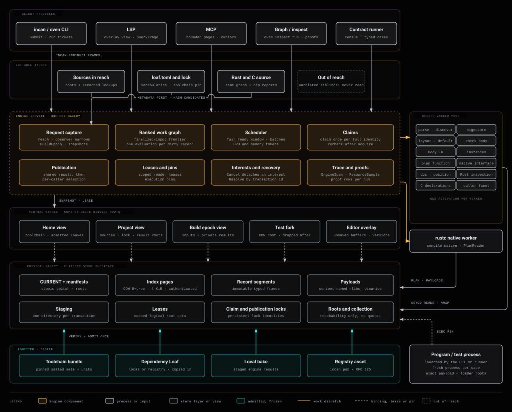

<!-- markdownlint-configure-file {"MD025": {"front_matter_title": ""}} -->

# DD-0013: The Incan build engine

## Context

The direct native route of DD-0004 takes Incan source through the checker and Body IR straight into the pinned rustc, with no Cargo and no emitted Rust, and passes the full contract census. The route's first build engine treated each compile as a fresh, self-contained job: every process loaded whole dependency closures, and nothing was shared between processes, projects or commands. Measuring that engine showed the cost:

- **Hello world reads the whole standard library.** To emit 11 native functions, a compile reads all standard manifests (12.1 MB) and requests about 400 bodies (#2481).
- **Processes hold what they no longer need.** An idle compiler worker keeps about 2 GiB. The contract runner grows to 10.4 GiB and `incan mcp` to 3.8 GiB.
- **Small questions get whole answers.** Asking about one unit returns the standard library's whole code graph, 64 MB (#2484).
- **Work is repeated.** `incan run` after `incan build` of the same file compiles it again. A cold CI-equivalent run takes 30.5 min and compiles some compiler Loaves 2 to 7 times. A one-function edit to the lowering library costs 271 s.

None of this comes from the language's semantics. It comes from what DD-0012 left open. DD-0012 decided what the compiler stores, but not the process that serves those records, how a command becomes work, who schedules and claims that work, or how memory, disk, tests and readers stay bounded.

## Decision

**Incan builds through one resident engine per physical bakery, with the architecture specified in the [build engine architecture](../contributing/explanation/build_engine_architecture.md).** This record commits to that architecture; the page is the plan of record, not one option among several.

The commitment in short:

- **One engine per physical bakery.** Homes, projects, test forks and editor overlays are virtual stores over it. It replaces the per-project owner, the ledgers and the whole-closure transport.
- **Commands are requests for roots.** A request names its results over an immutable input snapshot. Capture checks only what the request reaches: frozen content never, editable sources metadata first.
- **Record-by-record producers.** The checker, Body IR and lowering answer one record at a time through keyed, mapped reads with recorded read witnesses. Incan and Rust records share one ranked graph with early cutoff.
- **Each fact computed once.** Claims belong to the physical store. A shared result is published once and selected per caller.
- **Bounded by construction.** No process holds a dependency closure between requests. Readers answer bounded questions in bounded pages.
- **A platform layer under std and the engine.** The RFC 165 store substrate, memory mapping, durable I/O, IPC, process control, resource probes and tracing live in the platform; `std` and the engine are peers above it.
- **Incan only, no Cargo.** The only authored Rust is three named bootstrap adapters.
- **Delivery in measured stages.** Store stages S1 to S4 and engine stages E1 to E7 each exit on proofs measured in a cold and a warm home.

The architecture page holds the governing rules, the decision register (BE-01 to BE-34), the stage order, the proof tables and the code map.

> **Clarification (2026-11-06):** RFC 168 established `std.primitives` as the foundation below `incan_platform`; the platform is below every other standard package, not below the primitive package. The living architecture page reflects that dependency order.

This record supersedes two earlier rules:

- **DD-0012, decision 10:** "a missing or damaged record is a miss". A missing record is `Absent`; damage is a corruption `DbError` and never reads as absence.
- **DD-0004:** only the driver Loaf's own units may use rustc's internal interface. Any Loaf may, by declaring it in `loaf.toml`.

It refines DD-0012 in one respect: one engine per physical bakery, with homes as virtual stores over it.

## Consequences

- A command is a request for roots; the engine computes each missing fact once per physical store and every later request finds it.
- Memory follows the work running now: no process holds a dependency closure between requests.
- The store grows only by new facts; unchanged builds write nothing.
- Readers answer bounded questions with bounded work.
- The checker, Body IR and lowering become per-record producers; that restructuring is the main cost, as DD-0012 stated.
- The first engine's owner, ledger, stamp and whole-closure paths are removed once E7's acceptance holds.

## Non-goals

- A distributed cache, cross-user authorization or a networked store.
- A relational planner, Substrait, Protobuf or DataFusion inside the engine.
- New user-facing syntax or semantics.
- Bypassing platform security assessment of new executables.

## Revisit condition

Revisit if a producer needs whole-program state that per-record reads cannot express, if a proof row stays `failed` after its stage's work is complete, or if the pinned rustc cannot supply tracked native inputs.

## Provenance

The maintainer approved the engine design (v2, with decision register BE-01 to BE-33 and stages E1 to E7) and the storage design it builds on (stages S1 to S4) on 2026-10-30. The [build engine architecture](../contributing/explanation/build_engine_architecture.md) assembles them with the rules added in review of this record: capture and freshness, Rust and C interop, comments, docs and source positions (BE-34), and damaged records. The architecture page also holds the full engine design as its detailed contracts; the storage design is the [bakery storage design](../contributing/explanation/bakery_storage_design.md), and where it differs from the architecture page, the architecture page governs.

## References

- [Build engine architecture](../contributing/explanation/build_engine_architecture.md)
- DD-0004, DD-0007, DD-0008, DD-0012
- RFC 097, RFC 106, RFC 117, RFC 118, RFC 119, RFC 120, RFC 121, RFC 124, RFC 125, RFC 165, RFC 166
- #2481, #2484, #2471, #2482, #2483, #2491, #2493
