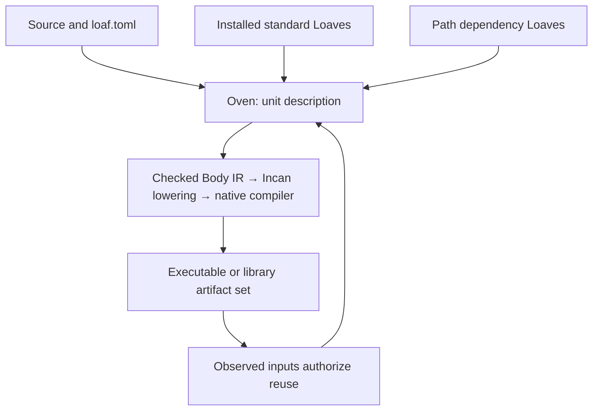

# Oven and Loaves

Oven is the `incan` command line, authored in Incan. It owns project intake, package-feature selection, dependency preparation, execution, formatting requests, graph inspection and toolchain archives.

The unit description is the boundary between project orchestration and the compiler. Semantic facts live in the checker and Body IR; build orchestration does not infer them independently.

A Loaf is the package boundary for checked declarations, retained bodies and native implementation artifacts. Standard packages follow that boundary too. Rust registry units are supplied by the installed toolchain closure.

Packed toolchains carry the driver and dependency artifacts with portable paths. Installation binds them to the local pinned Rust sysroot and verifies compiler identity before publication.

See [Projects](projects_today.md), [Standard-package flow](compiled_sdk_provider_flow.md) and [Install and run](../how-to/install_and_run.md).
